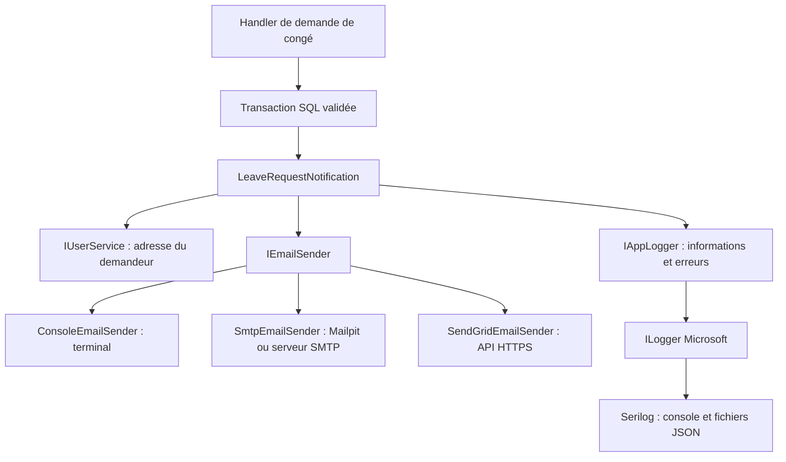

# Module 9 — Infrastructure Layer : e-mails et journalisation

Ce module ajoute les services transversaux à la gestion des congés : simulation des e-mails en développement, SMTP local avec Mailpit, envoi par SendGrid et journalisation avec Serilog. Toutes les commandes ci-dessous s’exécutent dans PowerShell, depuis `D:\Projects\HR.LeaveManagement.Clean`.

## 1. Comprendre le parcours d’une notification



Les contrats sont dans **Application** ; leurs implémentations techniques sont dans **Infrastructure**. Les handlers ne dépendent ni du SDK SendGrid ni de Serilog. L’API assemble les services par injection de dépendances.

Les notifications existantes concernent la création, la modification, le changement de décision et l’annulation d’une demande. Elles sont adressées à l’employé demandeur, avec un corps texte l’invitant à consulter l’application. Elles ne sont pas déclenchées par la connexion ou la création d’un utilisateur. Une approbation ou annulation qui ne change pas l’état n’envoie pas de nouvelle notification.

La notification s’exécute **après la transaction métier**. Si un fournisseur refuse un message ou tombe en panne, la demande reste enregistrée et le problème est journalisé. L’appel reste attendu par la requête HTTP ; les transports réseau ont une limite de 15 secondes. Il n’y a actuellement ni file durable, ni relance automatique, ni suivi de livraison. Une outbox serait nécessaire pour garantir les nouvelles tentatives après un arrêt du processus.

## 2. Fichiers et dépendances

| Fichier | Responsabilité |
|---|---|
| `Application/Contracts/Email/IEmailSender.cs` | Contrat `Task<bool> SendEmail(EmailMessage email)`. |
| `Application/Models/Email/EmailMessage.cs` | Destinataire, objet, corps texte. |
| `Application/Models/Email/EmailSettings.cs` | Paramètres liés à la section `EmailSettings`. |
| `Infrastructure/Services/ConsoleEmailSender.cs` | Afficher le message dans le terminal sans réseau. |
| `Infrastructure/Services/SmtpEmailSender.cs` | Envoyer par SMTP ; compatible avec Mailpit. |
| `Infrastructure/Services/SendGridEmailSender.cs` | Envoyer par le SDK officiel SendGrid, via HTTPS. |
| `Infrastructure/Services/DisabledEmailSender.cs` | Ne rien envoyer et retourner `false`. |
| `Infrastructure/Services/AppLogger.cs` | Adapter `IAppLogger<T>` vers `ILogger<T>`. |
| `Infrastructure/InfrastructureServiceRegistration.cs` | Lier et valider les options, sélectionner les services. |
| `Infrastructure/LoggingServiceRegistration.cs` | Configurer Serilog et les fichiers quotidiens. |
| `Api/Program.cs` | Brancher les services et la journalisation HTTP. |

Les chemins du tableau omettent le préfixe `HR.LeaveManagement.` pour faciliter la lecture.

Les références NuGet ajoutées au projet Infrastructure sont `SendGrid` **9.29.3**, `Serilog.AspNetCore` **10.0.0** et `Serilog.Sinks.File` **7.0.0**. Elles sont déjà inscrites dans le `.csproj` : il suffit de restaurer puis compiler.

```powershell
dotnet restore HR.LeaveManagement.Clean.slnx
dotnet build HR.LeaveManagement.Clean.slnx --no-restore
```

Les prérequis de l’application restent nécessaires : SDK .NET 10, SQL Server accessible, clé JWT et migrations des deux contextes appliquées. Voir le [démarrage local du README principal](../README.md#11-démarrage-local).

## 3. Simulation immédiate, comme dans Django

En Django, `django.core.mail.backends.console.EmailBackend` affiche les e-mails dans le terminal. Ici, `ConsoleEmailSender` remplit ce rôle.

`Api/appsettings.Development.json` active déjà :

```json
"EmailSettings": {
  "Enabled": true,
  "Provider": "Console"
}
```

Lancer l’API :

```powershell
dotnet run --project HR.LeaveManagement.Api --launch-profile https
```

Dans un deuxième terminal, lancer Blazor :

```powershell
dotnet run --project HR.LeaveManagement.BlazorUI --launch-profile https
```

Ouvrir `https://localhost:7040/connexion`. Pour provoquer une notification :

1. Se connecter comme administrateur et créer un type de congé.
2. Attribuer les allocations de ce type pour l’année courante. L’employé doit déjà exister lors de cette attribution.
3. Se connecter comme employé et soumettre une demande pour ce type, dans l’année allouée, avec un nombre de jours inférieur ou égal au solde.
4. Consulter le **terminal de l’API**. Un bloc indique `EMAIL LOCAL`, l’expéditeur, le destinataire, l’objet et le corps.
5. Revenir comme administrateur et approuver la demande : une autre notification apparaît.

Avec ce mode, même une adresse fictive comme `employe@example.test` convient. Aucun message n’est envoyé sur Internet. Le contenu complet est écrit directement dans la console de développement ; il n’est pas envoyé aux fichiers Serilog par ce service.

Si d’anciens secrets utilisateur sélectionnent un autre fournisseur, forcer temporairement la console dans le terminal API avant le lancement :

```powershell
$env:EmailSettings__Enabled = "true"
$env:EmailSettings__Provider = "Console"
```

## 4. Une boîte e-mail sur localhost avec Mailpit

Mailpit capture les messages SMTP et les affiche dans une interface web locale. Il permet de voir les messages avec leur destinataire, objet et contenu, sans les livrer aux adresses externes.

### Avec Docker Desktop

Démarrer Docker Desktop avec les conteneurs Linux, puis :

```powershell
docker compose -f compose.mailpit.yml up -d
```

Le fichier Compose fourni publie uniquement sur l’interface de boucle locale :

| Usage | Adresse |
|---|---|
| Boîte e-mail dans le navigateur | `http://localhost:8025` |
| Serveur SMTP utilisé par l’API | `127.0.0.1:1025` |

Arrêter l’API avec `Ctrl+C`, puis utiliser le nouveau profil :

```powershell
dotnet run --project HR.LeaveManagement.Api --launch-profile mailpit
```

Ce profil conserve les adresses API habituelles et définit `Provider=Smtp`, `Host=127.0.0.1`, `Port=1025`, `EnableSsl=false`, sans nom d’utilisateur. Blazor continue donc à appeler `https://localhost:7097/`.

Refaire le parcours de demande de congé décrit plus haut et ouvrir `http://localhost:8025`. Le message doit apparaître dans la boîte locale. Ni un compte SendGrid ni une adresse réelle ne sont nécessaires.

Pour arrêter Mailpit :

```powershell
docker compose -f compose.mailpit.yml down
```

Les messages restent dans le volume Docker `mailpit-data` et seront disponibles au prochain lancement.

### Sans Docker

Télécharger l’archive Windows correspondant à votre architecture depuis les [versions officielles de Mailpit](https://github.com/axllent/mailpit/releases), l’extraire dans un dossier de votre choix et exécuter :

```powershell
.\mailpit.exe --listen 127.0.0.1:8025 --smtp 127.0.0.1:1025
```

Garder ce terminal ouvert. Utiliser ensuite le même profil API `mailpit` et la même adresse web. `Ctrl+C` arrête le serveur natif. Le volume du fichier Compose ne concerne que le lancement Docker.

## 5. Activer SendGrid pour un envoi réel

1. Créer ou utiliser un compte SendGrid.
2. Vérifier une identité d’expéditeur (Single Sender Verification pour un essai, ou authentification d’un domaine).
3. Créer une clé API disposant du droit **Mail Send**.
4. Définir l’expéditeur et la clé dans la configuration locale. Remplacer les exemples ci-dessous par vos propres valeurs.

```powershell
dotnet user-secrets set "EmailSettings:SendGridApiKey" "VOTRE_CLE_SENDGRID" --project HR.LeaveManagement.Api
dotnet user-secrets set "EmailSettings:FromAddress" "adresse-verifiee@votre-domaine.com" --project HR.LeaveManagement.Api
dotnet user-secrets set "EmailSettings:FromName" "Service RH" --project HR.LeaveManagement.Api
```

Dans le terminal API, sélectionner SendGrid puis lancer le profil HTTPS :

```powershell
$env:EmailSettings__Enabled = "true"
$env:EmailSettings__Provider = "SendGrid"
dotnet run --project HR.LeaveManagement.Api --launch-profile https
```

Déclencher une demande de congé avec une adresse destinataire que vous contrôlez. Le SDK construit un e-mail `text/plain`, puis appelle `POST https://api.sendgrid.com/v3/mail/send`. Une réponse HTTP 2xx signifie que le fournisseur a accepté la requête ; elle ne prouve pas que la boîte du destinataire l’a reçue. Les refus sont journalisés avec leur code HTTP, sans recopier le corps de la réponse.

Le champ `FromAddress` doit correspondre à l’identité vérifiée ; `noreply@hr.local` sert uniquement aux essais locaux. La clé reste hors des sources. En hébergement, utiliser le gestionnaire de secrets ou les variables `EmailSettings__SendGridApiKey`, `EmailSettings__FromAddress`, `EmailSettings__Enabled=true` et `EmailSettings__Provider=SendGrid` : les secrets utilisateur sont destinés au développement.

Pour revenir à la simulation dans le même terminal :

```powershell
$env:EmailSettings__Provider = "Console"
dotnet run --project HR.LeaveManagement.Api --launch-profile https
```

Pour supprimer les variables temporaires et revenir aux paramètres des fichiers et secrets, fermer ce terminal ou exécuter :

```powershell
Remove-Item Env:EmailSettings__Provider -ErrorAction SilentlyContinue
Remove-Item Env:EmailSettings__Enabled -ErrorAction SilentlyContinue
```

## 6. Configuration SMTP et validation

Les paramètres SMTP existants restent disponibles :

```json
"EmailSettings": {
  "Enabled": true,
  "Provider": "Smtp",
  "FromAddress": "noreply@hr.local",
  "FromName": "Service RH",
  "Host": "127.0.0.1",
  "Port": 1025,
  "EnableSsl": false,
  "UserName": "",
  "Password": ""
}
```

Cet exemple correspond à Mailpit. Pour un serveur SMTP externe, adapter l’hôte, le port, STARTTLS et les identifiants selon le fournisseur ; stocker le mot de passe dans les secrets. `SmtpClient.EnableSsl` utilise STARTTLS, ce qui ne correspond pas au TLS implicite du port 465.

Au démarrage, `ValidateOnStart` vérifie les options : fournisseur reconnu, adresse d’expéditeur valide, hôte et port SMTP valides pour SMTP, clé non vide pour SendGrid. La console n’exige pas de serveur ni de clé. Avec `Enabled=false`, aucun transport n’est utilisé et les identifiants ne sont pas exigés. Les noms de fournisseurs ne sont pas sensibles à la casse.

La priorité de configuration est : `appsettings.json`, puis le fichier de l’environnement, puis les secrets utilisateur en développement, puis les variables d’environnement, puis les arguments de ligne de commande. Le profil `mailpit` injecte ses propres variables d’environnement. Après un changement de fournisseur ou d’identifiants, redémarrer l’API.

## 7. Serilog : comprendre et lire les journaux

`Program.cs` crée d’abord un logger de démarrage. Puis `AddInfrastructureLogging` branche Serilog sur les `ILogger<T>` Microsoft. Le bloc `try/catch/finally` enregistre les erreurs fatales et vide les buffers lors de l’arrêt.

Deux sorties sont configurées :

| Sortie | Contenu |
|---|---|
| Terminal API | Événements lisibles : date, niveau, catégorie, message et propriétés. |
| `HR.LeaveManagement.Api/Logs/hr-leave-AAAAMMJJ.json` | Une entrée JSON par ligne, avec les propriétés structurées et les exceptions. |

Le chemin du fichier est résolu à partir du dossier de contenu de l’API, même si la commande est lancée depuis la racine de la solution. `LogFiles:Path` permet de le remplacer. Rotation quotidienne, nouvelle rotation au-delà de 10 000 000 octets, conservation de 14 fichiers : plusieurs fichiers peuvent donc appartenir à la même journée. Le dossier `Logs` est ignoré par Git.

Pour suivre les événements depuis la racine :

```powershell
$log = Get-ChildItem .\HR.LeaveManagement.Api\Logs\*.json | Sort-Object LastWriteTime | Select-Object -Last 1
Get-Content -LiteralPath $log.FullName -Tail 20 -Wait
```

`Ctrl+C` arrête seulement cette lecture. Pour lire les champs d’une entrée :

```powershell
Get-Content -LiteralPath $log.FullName -Tail 1 | ConvertFrom-Json | Format-List
```

Chaque requête HTTP produit un événement avec `RequestMethod`, `RequestPath`, `StatusCode`, `Elapsed` et `RequestId`. Les identifiants de trace ASP.NET sont aussi conservés lorsqu’ils sont présents. Le middleware Serilog entoure le gestionnaire d’exceptions afin de voir le **statut final**, y compris pour une erreur métier interceptée.

Tester avec `https://localhost:7097/health`. L’API doit répondre `Healthy` et une ligne doit indiquer le statut `200`. Une requête vers une route protégée sans jeton produit `401`. Les corps HTTP, les en-têtes d’authentification et le contenu des e-mails ne sont pas ajoutés par le middleware de requêtes.

Les niveaux se règlent dans `Api/appsettings.json`, section `Serilog:MinimumLevel` :

| Niveau | Exemple |
|---|---|
| `Information` | Requête HTTP terminée, message accepté par un fournisseur. |
| `Warning` | Message refusé, notification désactivée ou adresse manquante. |
| `Error` | Exception d’envoi avec pile d’appels, erreur applicative inattendue. |
| `Fatal` | Échec fatal au démarrage ou arrêt inattendu de l’API. |

`Microsoft.AspNetCore`, `Microsoft.EntityFrameworkCore` et les traces du client HTTP sont limités à `Warning` par défaut pour réduire le bruit. Pour augmenter temporairement les traces de l’application :

```powershell
$env:Serilog__MinimumLevel__Default = "Debug"
dotnet run --project HR.LeaveManagement.Api --launch-profile https
```

Utiliser des paramètres structurés dans le code :

```csharp
logger.LogInformation("Leave notification processed for employee {EmployeeId}.", employeeId);
logger.LogError(exception, "Leave notification failed for employee {EmployeeId}.", employeeId);
```

`EmployeeId` devient un champ exploitable dans le JSON. Avec une interpolation `$"...{employeeId}"`, il ne resterait qu’un texte formaté. Ne pas ajouter de mots de passe, jetons ou corps de messages aux événements applicatifs.

## 8. Injection des services transversaux

Dans l’API :

```csharp
builder.Services.AddInfrastructureLogging(builder.Configuration, builder.Environment);
builder.Services.AddInfrastructureServices(builder.Configuration);
```

`AddInfrastructureServices` lie les options avec `IOptions<EmailSettings>`, enregistre le client HTTP SendGrid via `IHttpClientFactory` et choisit une implémentation de `IEmailSender`. Les émetteurs et `AppLogger<T>` sont `Transient`, car ils ne conservent pas d’état de session. Les connexions HTTP sont gérées par la factory. `LeaveRequestNotification`, déjà enregistré dans Application, reçoit automatiquement ces services par son constructeur.

Un handler reçoit `LeaveRequestNotification` ; ce service reçoit `IEmailSender` et `IAppLogger<LeaveRequestNotification>`. Changer de fournisseur se fait dans la configuration sans modifier les règles de congé. `AppLogger<T>` délègue à `ILogger<T>` ; Serilog reçoit donc à la fois les événements métier et les événements ASP.NET Core.

## 9. Vérifications et diagnostic

```powershell
dotnet test --project HR.LeaveManagement.Application.UnitTests
dotnet test --solution HR.LeaveManagement.Clean.slnx
```

Le premier projet vérifie notamment la sélection des fournisseurs, les options invalides, la sortie console, les requêtes et refus SendGrid avec un transport HTTP simulé, SMTP avec un serveur de boucle locale, les exceptions des notifications et les fichiers JSON Serilog. Ces tests n’utilisent aucune clé SendGrid réelle et n’envoient aucun e-mail externe. Les tests d’intégration de la solution utilisent leur base SQL temporaire habituelle.

| Symptôme | Vérification |
|---|---|
| Aucun e-mail dans Mailpit | Lancer le profil API `mailpit`, vérifier que la demande a réussi et qu’elle change l’état. |
| Le message apparaît seulement dans le terminal | Le fournisseur actif est `Console`. |
| Connexion SMTP refusée | Mailpit doit tourner ; vérifier `127.0.0.1:1025` et l’absence de conflit de port. |
| Erreur TLS avec Mailpit | Le profil local doit avoir `EnableSsl=false`. |
| `docker` introuvable | Installer Docker Desktop ou utiliser le binaire natif ; le mode console fonctionne sans les deux. |
| SendGrid refuse la requête | Vérifier le code HTTP journalisé, la clé, le droit Mail Send et l’expéditeur vérifié. |
| Options invalides au démarrage | Lire le message de validation ; vérifier les secrets et variables qui remplacent les fichiers JSON. |
| API indisponible avant tout essai | Vérifier d’abord SQL Server, JWT et migrations avec le README principal. |
| Demande enregistrée, notification en erreur | Comportement prévu : la transaction est conservée ; il n’y a pas de relance automatique. |

## 10. Worker de statistiques : console et table `stats`

`ApplicationStatsWorker` est un `BackgroundService` démarré automatiquement avec l’API. Il attend **3 minutes avant le premier relevé**, puis recommence à chaque intervalle. Il ne nécessite ni appel HTTP ni connexion dans Blazor.

Le relevé compte toutes les lignes de `LeaveAllocations`, `LeaveRequests` et `LeaveTypes`, sans filtre d’utilisateur ni de période. Le total des demandes inclut les demandes annulées et rejetées. Le worker calcule également les nombres, durées moyennes et pourcentages des demandes en attente, approuvées et annulées. Il enregistre une nouvelle ligne dans `dbo.stats`, puis affiche les mêmes valeurs dans la console de l’API via Serilog.

| Colonne de `stats` | Contenu |
|---|---|
| `Id` | Identifiant de l’instantané. |
| `CapturedAtUtc` | Date et heure UTC du début du relevé. |
| `LeaveAllocationCount` | Nombre d’allocations. |
| `LeaveRequestCount` | Nombre de demandes. |
| `LeaveTypeCount` | Nombre de types de congé. |
| `PendingLeaveRequestCount` | Nombre de demandes non annulées dont `Approved` vaut `null`. |
| `ApprovedLeaveRequestCount` | Nombre de demandes non annulées dont `Approved` vaut `true`. |
| `CancelledLeaveRequestCount` | Nombre de demandes dont `Cancelled` vaut `true`, quelle que soit l’ancienne décision. |
| `PendingLeaveRequestAverageDays` | Durée moyenne en jours des demandes en attente. |
| `ApprovedLeaveRequestAverageDays` | Durée moyenne en jours des demandes approuvées actives. |
| `CancelledLeaveRequestAverageDays` | Durée moyenne en jours des demandes annulées. |
| `PendingLeaveRequestPercentage` | Pourcentage du total des demandes qui sont en attente. |
| `ApprovedLeaveRequestPercentage` | Pourcentage du total des demandes qui sont approuvées et non annulées. |
| `CancelledLeaveRequestPercentage` | Pourcentage du total des demandes qui sont annulées. |

Les instantanés précédents sont conservés. Il ne s’agit pas du nombre de créations pendant les trois dernières minutes, mais des volumes totaux présents lors du relevé.

Les catégories sont disjointes : une demande approuvée puis annulée compte uniquement dans les annulations. Les demandes rejetées non annulées sont incluses dans `LeaveRequestCount`, mais pas dans ces trois catégories ; les trois pourcentages ne totalisent donc pas nécessairement 100 %.

Pour chaque catégorie :

- **Durée moyenne** = somme des durées calendaires inclusives (`date de fin - date de début + 1 jour`) divisée par le nombre de demandes de la catégorie. Les heures sont ignorées, comme dans les règles de congé. Il ne s’agit ni d’une durée d’attente de décision ni des jours effectivement déduits du solde.
- **Pourcentage** = nombre de demandes de la catégorie × 100 / nombre total de demandes, rejets inclus.

Les valeurs sont arrondies à deux décimales. Sans demande dans une catégorie, sa durée moyenne est `NULL`. Sans aucune demande, les trois compteurs et pourcentages valent zéro. Pour les relevés antérieurs à la migration `AddLeaveRequestStatusStatistics`, les neuf nouvelles colonnes restent `NULL` : ces informations historiques n’ont pas été mesurées et ne sont pas recalculées avec les données actuelles.

### Créer la table

Les migrations `AddApplicationStats` (table initiale) et `AddLeaveRequestStatusStatistics` (répartition et moyennes) sont fournies. Depuis la racine, appliquer les migrations du contexte métier :

```powershell
dotnet ef database update --context HrDatabaseContext --project HR.LeaveManagement.Persistence --startup-project HR.LeaveManagement.Api
```

Si l’API tourne déjà, l’arrêter avec `Ctrl+C` avant de recompiler et de la relancer. Ses fichiers de compilation peuvent être verrouillés pendant son exécution.

### Configurer la durée

Dans `HR.LeaveManagement.Api/appsettings.json` :

```json
"StatsWorker": {
  "Enabled": true,
  "Interval": "00:03:00"
}
```

`Interval` est une durée `TimeSpan` au format `hh:mm:ss`. Exemples : `00:00:10` pour dix secondes, `00:05:00` pour cinq minutes, `01:00:00` pour une heure. Une durée nulle, négative, inférieure à une milliseconde ou supérieure à 49 jours est refusée au démarrage.

Pour un essai rapide sans modifier les fichiers :

```powershell
$env:StatsWorker__Interval = "00:00:10"
dotnet run --project HR.LeaveManagement.Api --launch-profile https
```

Après dix secondes, un message semblable apparaît dans la console :

```text
Statistiques enregistrées (Id=1, UTC=...) : LeaveAllocation=3, LeaveRequest=1, LeaveType=1.
En attente=1 (100.00 %, durée moyenne=3.00 jours), Approuvées=0 (0.00 %, durée moyenne=null jours), Annulées=0 (0.00 %, durée moyenne=null jours).
```

Les nombres dépendent de votre base. Vérifier ensuite les lignes dans SQL Server Management Studio :

```sql
SELECT TOP (20)
    Id, CapturedAtUtc, LeaveAllocationCount, LeaveRequestCount, LeaveTypeCount,
    PendingLeaveRequestCount, PendingLeaveRequestAverageDays, PendingLeaveRequestPercentage,
    ApprovedLeaveRequestCount, ApprovedLeaveRequestAverageDays, ApprovedLeaveRequestPercentage,
    CancelledLeaveRequestCount, CancelledLeaveRequestAverageDays, CancelledLeaveRequestPercentage
FROM dbo.stats
ORDER BY Id DESC;
```

Pour revenir à trois minutes, arrêter l’API, supprimer la variable du terminal puis relancer :

```powershell
Remove-Item Env:StatsWorker__Interval -ErrorAction SilentlyContinue
dotnet run --project HR.LeaveManagement.Api --launch-profile https
```

`StatsWorker:Enabled=false` désactive ce worker. Redémarrer l’API après un changement de durée ou d’activation.

### Comprendre le code

1. `InfrastructureServiceRegistration` lie et valide `StatsWorkerOptions`, puis enregistre le worker avec `AddHostedService<ApplicationStatsWorker>()`.
2. `ApplicationStatsWorker` utilise un `PeriodicTimer` ; le premier relevé attend le premier tick, et deux relevés ne s’exécutent pas en parallèle dans une même instance.
3. À chaque tick, le worker crée un scope d’injection avec `CreateAsyncScope`. Ce scope fournit un nouveau `HrDatabaseContext` via `IApplicationStatsRepository`.
4. `ApplicationStatsRepository`, dans Persistence, compte les tables et groupe les demandes par statut directement dans SQL Server. `DATEDIFF(day, StartDate, EndDate) + 1` fournit les durées inclusives utilisées par `AVG`. Il enregistre `ApplicationStat` dans une transaction sérialisable, via l’`IUnitOfWork` existante : totaux, répartition et moyennes sont donc cohérents entre eux.
5. Après validation SQL, le worker journalise les compteurs au niveau `Information`. Ils apparaissent dans la console et dans les fichiers JSON Serilog.
6. En cas d’erreur SQL, il journalise l’exception et attend le prochain tick. L’arrêt de l’API annule proprement l’attente et les requêtes en cours.

Le worker utilise un `TimeProvider` pour rendre les tests de temporisation indépendants d’une attente réelle de trois minutes. Les tests vérifient le délai initial, l’intervalle configuré, la création et la libération des scopes, la reprise après erreur et l’annulation. Les tests SQL vérifient les compteurs, les statuts exclusifs, les durées inclusives, les arrondis, les rejets dans le dénominateur et le cas des tables vides. Un test de migration sur une base temporaire vérifie aussi la conservation des anciens relevés avec des mesures nouvelles à `NULL`.

Le worker fonctionne tant que l’API est démarrée. Le délai repart au lancement ; les relevés manqués pendant un arrêt ne sont pas recréés. Si plusieurs instances de l’API tournent, chacune produit ses propres relevés. Aucun mécanisme de coordination entre instances ni suppression automatique de l’historique n’est ajouté.

Références officielles : [SDK C# SendGrid](https://github.com/sendgrid/sendgrid-csharp), [identité d’expéditeur SendGrid](https://www.twilio.com/docs/sendgrid/for-developers/sending-email/sender-identity), [Serilog pour ASP.NET Core](https://github.com/serilog/serilog-aspnetcore), [Mailpit avec Docker](https://mailpit.axllent.org/docs/install/docker/), [scopes dans un BackgroundService](https://learn.microsoft.com/en-us/dotnet/core/extensions/scoped-service).
