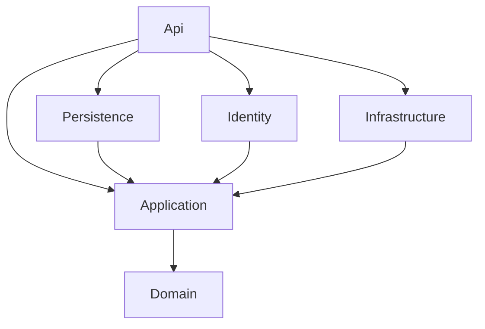
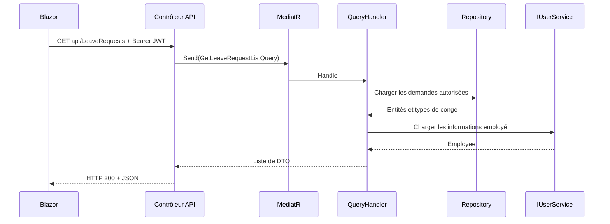

# HR Leave Management — guide de compréhension et de réutilisation

Application de gestion des congés en **.NET 10** : API ASP.NET Core, interface Blazor en mode interactif serveur, SQL Server, Entity Framework Core, ASP.NET Core Identity et JWT.

Ce guide explique le code présent dans la solution, le rôle de ses classes et les parcours entre couches. Il propose ensuite une démarche pour réutiliser cette organisation dans d’autres projets.

L’organisation actuelle privilégie des traitements visibles dans les handlers : la validation est appelée explicitement, les règles des demandes sont regroupées dans `Features/LeaveRequest`, et les mappings sont séparés par fonctionnalité. L’interface Blazor expose désormais les pages de connexion, de gestion des utilisateurs, des types et des allocations, en complément du suivi des demandes.

Pour démarrer, suivre la [configuration locale](#11-démarrage-local). Pour comprendre les changements de structure, consulter les [repères sur les évolutions](#15-repères-sur-les-évolutions-du-projet). Le [guide Blazor](HR.LeaveManagement.BlazorUI/README.md) détaille l’organisation de l’interface.

## Sommaire

1. [Le besoin métier](#1-le-besoin-métier)
2. [L’architecture et les projets](#2-larchitecture-et-les-projets)
3. [Les entités du domaine](#3-les-entités-du-domaine)
4. [La couche Application](#4-la-couche-application)
5. [Les parcours complets](#5-les-parcours-complets)
6. [La persistance et les transactions](#6-la-persistance-et-les-transactions)
7. [Identity, JWT et les droits](#7-identity-jwt-et-les-droits)
8. [L’API et les erreurs HTTP](#8-lapi-et-les-erreurs-http)
9. [Blazor et les services techniques](#9-blazor-et-les-services-techniques)
10. [Lire la syntaxe C#](#10-lire-la-syntaxe-c)
11. [Démarrage local](#11-démarrage-local)
12. [Les tests](#12-les-tests)
13. [Reproduire cette architecture](#13-reproduire-cette-architecture)
14. [Ordre de lecture et exercices](#14-ordre-de-lecture-et-exercices)
15. [Repères sur les évolutions du projet](#15-repères-sur-les-évolutions-du-projet)

## 1. Le besoin métier

| Concept | Question | Exemple |
|---|---|---|
| `LeaveType` : type de congé | Quelle catégorie existe et combien de jours sont attribués par défaut ? | Congé annuel, 20 jours par défaut. |
| `LeaveAllocation` : allocation | Combien de jours restent disponibles pour un employé, un type et une année ? | Alice dispose de 20 jours de congé annuel pour une année donnée. |
| `LeaveRequest` : demande | Quelles dates l’employé veut-il prendre et quelle décision a été prise ? | Alice demande du 10 au 14 mai, soit 5 jours calendaires. |

`DefaultDays` est la valeur utilisée à la création d’une allocation. `NumberOfDays` est le **solde disponible**, qui évolue avec les approbations et les restitutions.

```text
L’administrateur crée le type « Congé annuel », DefaultDays = 20
    → Il lance l’attribution pour l’année courante
    → Une allocation de 20 jours est créée pour chaque employé concerné

Alice soumet une demande de 5 jours
    → Le solde est vérifié, il reste à 20

L’administrateur approuve
    → Le solde est vérifié à nouveau puis passe à 15
    → La demande mémorise DeductedDays = 5

La demande approuvée est annulée
    → Les 5 jours mémorisés sont restitués
    → Le solde revient à 20
```

Créer une demande ne réserve donc pas les jours. Plusieurs demandes peuvent rester en attente ; chacune devra disposer d’un solde suffisant lors de son approbation.

## 2. L’architecture et les projets

### 2.1. Responsabilités des projets

| Projet | Responsabilité | Points d’entrée |
|---|---|---|
| `Domain` | Décrire les données métier et leur identité. | [LeaveRequest](HR.LeaveManagement.Domain/LeaveRequest.cs), [LeaveAllocation](HR.LeaveManagement.Domain/LeaveAllocation.cs), [LeaveType](HR.LeaveManagement.Domain/LeaveType.cs). |
| `Application` | Définir les cas d’utilisation, règles applicatives et contrats. | `Features`, `Contracts`, `MappingProfiles`. |
| `Persistence` | Implémenter l’accès SQL Server, les repositories et les transactions EF Core. | [HrDatabaseContext](HR.LeaveManagement.Persistence/DatabaseContext/HrDatabaseContext.cs), [UnitOfWork](HR.LeaveManagement.Persistence/UnitOfWork.cs). |
| `Identity` | Gérer les comptes, mots de passe, rôles, JWT et opérations d’administration des utilisateurs. | [AuthService](HR.LeaveManagement.Identity/Services/AuthService.cs), [UserService](HR.LeaveManagement.Identity/Services/UserService.cs), [UserAdministrationService](HR.LeaveManagement.Identity/Services/UserAdministrationService.cs). |
| `Infrastructure` | Fournir les notifications et la journalisation. | [SmtpEmailSender](HR.LeaveManagement.Infrastructure/Services/SmtpEmailSender.cs), [AppLogger](HR.LeaveManagement.Infrastructure/Services/AppLogger.cs). |
| `Api` | Exposer les opérations par HTTP et assembler les implémentations. | [Program.cs](HR.LeaveManagement.Api/Program.cs), `Controllers`, `Middleware`. |
| `BlazorUI` | Afficher les écrans et appeler l’API. | [Home.razor](HR.LeaveManagement.BlazorUI/Components/Pages/Home.razor), [LeaveApiClient](HR.LeaveManagement.BlazorUI/Services/LeaveApiClient.cs). |
| `Application.UnitTests` | Vérifier les règles, les exceptions, les mappings, le client API et l’état d’authentification Blazor. | [LeaveRulesTests](HR.LeaveManagement.Application.UnitTests/LeaveRulesTests.cs), [ApiClientTests](HR.LeaveManagement.Application.UnitTests/ApiClientTests.cs), [ExceptionTests](HR.LeaveManagement.Application.UnitTests/ExceptionTests.cs). |
| `Persistence.IntegrationTests` | Vérifier l’API avec Identity, les migrations, SQL Server et les réponses d’erreur. | [LeaveApiTests](HR.LeaveManagement.Persistence.IntegrationTests/LeaveApiTests.cs), [UserAdministrationTests](HR.LeaveManagement.Persistence.IntegrationTests/UserAdministrationTests.cs), [GlobalExceptionHandlerTests](HR.LeaveManagement.Persistence.IntegrationTests/GlobalExceptionHandlerTests.cs), [ApiFixture](HR.LeaveManagement.Persistence.IntegrationTests/ApiFixture.cs). |

Les noms du tableau sont abrégés : chaque projet porte le préfixe `HR.LeaveManagement.`.

### 2.2. Le sens des dépendances

La règle centrale de cette Clean Architecture est que le code métier ne doit pas connaître les détails techniques de ses implémentations.

Les flèches suivantes représentent les **références entre projets**, pas l’ordre des appels :



Blazor communique avec l’API par HTTP. Il ne référence pas les projets métier et possède ses propres modèles dans `Models/ApiModels.cs`.

Exemple d’inversion des dépendances :

```text
Application définit ILeaveRequestRepository
Persistence fournit LeaveRequestRepository : ILeaveRequestRepository
Api enregistre la correspondance dans le conteneur de services
Les handlers de demandes reçoivent ILeaveRequestRepository
```

`Application` peut demander « enregistrer cette demande » sans connaître SQL Server, `DbContext` ou les chaînes de connexion.

### 2.3. L’organisation d’Application

```text
HR.LeaveManagement.Application/
├── Contracts/         Interfaces vers les services techniques
│   ├── Persistence/   Repositories et IUnitOfWork
│   ├── Identity/      IAuthService, IUserService et IUserAdministrationService
│   ├── Email/         IEmailSender
│   └── Logging/       IAppLogger<T>
├── Features/          Cas d’utilisation regroupés par fonctionnalité
│   ├── LeaveType/
│   ├── LeaveAllocation/
│   └── LeaveRequest/
│       ├── Commands/  Traitements des actions et transactions
│       ├── Queries/   Lectures et filtrage des données
│       └── Shared/    Règles communes et notifications
├── MappingProfiles/   Transformations AutoMapper
├── Models/            Messages et modèles des services
└── Exceptions/        Erreurs reconnues par l’API
```

Pour comprendre la création d’une demande, commencer par `Features/LeaveRequest/Commands/CreateLeaveRequest`.

Certains espaces de noms utilisent `LeaveRequests.Requests.Commands` au pluriel alors que les fichiers se trouvent dans `Features/LeaveRequest/Commands`. C# accepte ces différences. Suivre les types et les `using` en plus des dossiers.

## 3. Les entités du domaine

### 3.1. BaseEntity

[BaseEntity.cs](HR.LeaveManagement.Domain/Common/BaseEntity.cs) est une classe abstraite commune aux trois entités métier.

| Propriété | Signification |
|---|---|
| `Id` | Identifiant de l’enregistrement. |
| `DateCreated`, `CreatedBy` | Date UTC et utilisateur de création. |
| `DateModified`, `ModifiedBy` | Date UTC et utilisateur de dernière modification. |

Ces champs sont renseignés dans `HrDatabaseContext.SaveChangesAsync`. Chaque handler n’a donc pas à recopier ce traitement.

### 3.2. LeaveType et LeaveAllocation

`LeaveType` contient `Name` et `DefaultDays`.

`LeaveAllocation` contient :

- `EmployeeId` : identifiant Identity de l’employé.
- `LeaveTypeId` : identifiant du type.
- `Period` : année de l’allocation.
- `NumberOfDays` : solde disponible.
- `LeaveType` : propriété de navigation vers le type.

`LeaveTypeId` est la clé étrangère stockée ; `LeaveType` est l’objet associé, que l’on peut charger avec EF Core.

La combinaison `(EmployeeId, LeaveTypeId, Period)` possède un index unique : un employé ne peut avoir deux allocations du même type pour la même année.

### 3.3. LeaveRequest et ses états

| Propriété | Signification |
|---|---|
| `StartDate`, `EndDate` | Période demandée. |
| `LeaveTypeId` | Type de congé demandé. |
| `RequestingEmployeeId` | Employé propriétaire de la demande. |
| `RequestComments` | Commentaires du demandeur. |
| `DateRequested` | Date UTC de soumission. |
| `Approved` | `null` : en attente ; `true` : approuvée ; `false` : rejetée. |
| `Cancelled` | Indique si la demande est annulée. |
| `DeductedDays` | Nombre exact de jours actuellement déduits du solde. |

`Approved` est un `bool?` : un booléen qui accepte aussi `null`.

L’annulation est une information séparée : elle ne remet pas nécessairement `Approved` à `null`. Pour interpréter l’état, il faut aussi regarder `Cancelled`.

Dans cette solution, les entités décrivent surtout les données. La majorité des règles réside dans les handlers d’`Application/Features/LeaveRequest` et dans son dossier `Shared`. Modifier directement une propriété de l’entité ne déclenche pas automatiquement les contrôles des handlers.

## 4. La couche Application

### 4.1. Commands et Queries : CQRS

Une **Command** exprime une intention de modifier l’état du système. Une **Query** demande des informations sans effectuer ces changements métier.

| Élément | Exemple | Résultat |
|---|---|---|
| Command | `CreateLeaveRequestCommand` | Création d’une demande. |
| Command | `CreateLeaveTypeCommand` | Création d’un type et retour de son identifiant. |
| Query | `GetLeaveRequestListQuery` | Liste de DTO de demandes. |
| Query | `GetLeaveRequestDetailQuery` | Détail d’une demande autorisée. |

CQRS n’impose pas deux bases : ici, les commandes et les requêtes utilisent la même base applicative.

### 4.2. Command, Handler, Validator et DTO

| Élément | Rôle |
|---|---|
| Command / Query | Transporter les paramètres d’un cas d’utilisation. |
| Handler | Recevoir le message, appeler son validateur s’il existe, puis exécuter le traitement ou déléguer à un service. |
| Validator | Vérifier les données d’entrée avant le traitement. |
| DTO | Définir les données retournées au client sans exposer toute l’entité. |
| Shared | Regrouper les règles et notifications réutilisées par les handlers de la fonctionnalité. |

Exemple réel de commande :

```csharp
public class CreateLeaveRequestCommand : BaseLeaveRequest, IRequest<Unit>
{
    public string RequestComments { get; set; } = string.Empty;
}
```

`BaseLeaveRequest` apporte `StartDate`, `EndDate` et `LeaveTypeId`. `IRequest<Unit>` indique à MediatR le type de réponse attendu. `Unit` représente l’absence de donnée métier à retourner.

Une commande n’est pas une table SQL et ne s’exécute pas toute seule. Elle est transmise à MediatR. À l’inverse de cette création de demande, la création d’un type attend un `int`, car le handler retourne son identifiant.

### 4.3. MediatR et les handlers

Le contrôleur envoie un message :

```csharp
await _sender.Send(command, cancellationToken);
```

MediatR retrouve le handler associé au type du message :

```csharp
public sealed class CreateLeaveRequestCommandHandler(
    ILeaveRequestRepository requests,
    ILeaveAllocationRepository allocations,
    IUserService user,
    IUnitOfWork unitOfWork,
    IMapper mapper,
    LeaveRequestNotification notification,
    IValidator<CreateLeaveRequestCommand> validator)
    : IRequestHandler<CreateLeaveRequestCommand, Unit>
{
    public async Task<Unit> Handle(
        CreateLeaveRequestCommand request,
        CancellationToken cancellationToken)
    {
        var validationResult = await validator.ValidateAsync(request, cancellationToken);
        if (!validationResult.IsValid)
        {
            throw new BadRequestException("Validation failed", validationResult.Errors);
        }

        var employeeId = user.UserId ?? throw new ForbiddenException();

        await unitOfWork.ExecuteAsync(async () =>
        {
            var days = LeaveRequestRules.GetDays(request.StartDate, request.EndDate);
            var allocation = await allocations.GetUserAllocations(employeeId, request.LeaveTypeId, request.StartDate.Year)
                ?? throw new BadRequestException("No allocation exists for this leave type and year.");

            if (days > allocation.NumberOfDays)
            {
                throw new BadRequestException("Insufficient leave balance.");
            }

            var entity = mapper.Map<Domain.LeaveRequest>(request);
            entity.RequestingEmployeeId = employeeId;
            entity.DateRequested = DateTime.UtcNow;
            await requests.CreateAsync(entity);
            return true;
        }, cancellationToken);

        await notification.SendAsync(employeeId, "Leave request submitted");
        return Unit.Value;
    }
}
```

`IRequestHandler<CreateLeaveRequestCommand, Unit>` associe le handler au message et au type de réponse. Le handler valide les données, vérifie le solde et enregistre la demande dans une transaction. La notification est envoyée après la transaction.

MediatR fonctionne **dans le processus de l’API**. Ce n’est pas une file de messages entre serveurs.

### 4.4. Les traitements dans les handlers de commandes

| Commande de demande | Handler qui porte le traitement |
|---|---|
| `CreateLeaveRequestCommand` | `CreateLeaveRequestCommandHandler` |
| `UpdateLeaveRequestCommand` | `UpdateLeaveRequestCommandHandler` |
| `ChangeLeaveRequestApprovalCommand` | `ChangeLeaveRequestApprovalCommandHandler` |
| `CancelLeaveRequestCommand` | `CancelLeaveRequestCommandHandler` |
| `DeleteLeaveRequestCommand` | `DeleteLeaveRequestCommandHandler` |

Les commandes définissent les actions acceptées et leurs données. Chaque handler contient directement les vérifications, la transaction et les écritures de son action. Tout ce code se trouve dans `Features/LeaveRequest`.

Dans `Shared`, `LeaveRequestRules` regroupe le calcul des jours et le contrôle propriétaire/administrateur. `LeaveRequestNotification` regroupe l’envoi des emails pour éviter de répéter ce code dans les quatre handlers qui notifient le demandeur.

### 4.5. Différence avec LeaveAllocation/Commands

Les commandes d’allocation administrent les soldes annuels. Leurs handlers utilisent directement les contrats de repositories et `IUnitOfWork`.

| Commande | Comportement |
|---|---|
| `CreateLeaveAllocationCommand` | Reçoit un `LeaveTypeId`, charge les utilisateurs du rôle `Employee` et crée les allocations manquantes pour l’année UTC courante avec `type.DefaultDays`. |
| `UpdateLeaveAllocationCommand` | Modifie le solde ; interdit de déplacer une allocation vers un autre type ou une autre année. |
| `DeleteLeaveAllocationCommand` | Interdit la suppression si une demande approuvée non annulée utilise l’allocation. |

Ces trois handlers exigent un administrateur.

Créer une allocation ne crée donc aucune demande : cela fournit le solde que les handlers de demandes vérifieront et ajusteront.

### 4.6. Validation explicite dans les handlers

Chaque handler de commande disposant d’un validateur reçoit un `IValidator<SaCommande>` dans son constructeur. Il appelle ce validateur au début de `Handle`, avant tout traitement métier :

```csharp
var validationResult = await validator.ValidateAsync(request, cancellationToken);

if (!validationResult.IsValid)
{
    throw new BadRequestException("Validation failed", validationResult.Errors);
}
```

`ValidateAsync` vérifie les règles définies par le validateur. `IsValid` indique si les données sont acceptables. En cas d’erreur, l’exception interrompt le handler et l’API renvoie HTTP 400 avec les messages. Sinon, les instructions suivantes s’exécutent normalement.

```text
_sender.Send(...)
    → Handler
    → Validator de la commande
    → Règles, transaction et repositories dans le handler
```

Le validateur de création de demande réutilise `BaseLeaveRequestValidator`, puis limite les commentaires à 1 000 caractères. Les règles communes contrôlent les dates, l’année unique et l’existence du type.

Les sept handlers concernés sont ceux de création et modification des types, des allocations et des demandes, ainsi que celui d’approbation des demandes. Les queries, annulations et suppressions n’ont pas de validateur dédié actuellement ; leurs contrôles d’accès, d’existence et d’état restent dans leurs traitements.

Lors de l’ajout d’une nouvelle commande avec un validateur, injecter celui-ci et l’appeler dans le handler. Enregistrer un validateur dans le conteneur ne suffit pas à l’exécuter.

La validation ne remplace pas les vérifications métier transactionnelles : un solde peut changer entre la validation d’entrée et l’approbation.

### 4.7. AutoMapper

Les conversions entre commandes, entités et DTO sont réparties par fonctionnalité :

- [LeaveAllocationProfile.cs](HR.LeaveManagement.Application/MappingProfiles/LeaveAllocationProfile.cs) : mappings des allocations.
- [LeaveRequestProfile.cs](HR.LeaveManagement.Application/MappingProfiles/LeaveRequestProfile.cs) : mappings des demandes.
- [LeaveTypeProfile.cs](HR.LeaveManagement.Application/MappingProfiles/LeaveTypeProfile.cs) : mappings des types de congé.

Ces profils sont découverts automatiquement par `AddAutoMapper` dans `ApplicationServiceRegistration.cs`.

| Profil | Conversions configurées |
|---|---|
| `LeaveAllocationProfile` | Allocation vers DTO de liste et de détail ; commande de modification vers allocation. |
| `LeaveRequestProfile` | Demande vers DTO de liste et de détail ; commandes de création et modification vers demande. |
| `LeaveTypeProfile` | Type et DTO de liste dans les deux sens ; type vers DTO de détail ; commandes de création et modification vers type. |

Par exemple, [LeaveAllocationDto.cs](HR.LeaveManagement.Application/Features/LeaveAllocation/Queries/GetLeaveAllocations/LeaveAllocationDto.cs) contient à la fois `LeaveTypeId` et `LeaveType`. Le premier identifie le type pour les actions de modification ; le second permet d’afficher son nom et ses paramètres. `EmployeeId` identifie le propriétaire, tandis que `Period` et `NumberOfDays` décrivent l’année et le solde.

Les trois conversions d’allocations et les quatre conversions de demandes se trouvent dans leurs profils respectifs. Aucun enregistrement manuel de chaque profil n’est nécessaire.

```csharp
// Créer une entité à partir d’une commande.
var entity = mapper.Map<Domain.LeaveRequest>(command);

// Copier les données vers une entité existante.
mapper.Map(command, entity);
```

`.ForMember(x => x.Employee, o => o.Ignore())` indique que le mapping ne remplit pas `Employee`. Le handler récupère ces informations via `IUserService`.

Pour la modification d’une demande, `Cancelled` est ignoré par le mapping : l’annulation doit passer par son action dédiée, qui peut restituer des jours.

AutoMapper copie des données ; il ne remplace ni les droits d’accès ni les règles d’approbation.

### 4.8. Injection de dépendances

[ApplicationServiceRegistration.cs](HR.LeaveManagement.Application/ApplicationServiceRegistration.cs) enregistre notamment :

```csharp
services.AddScoped<LeaveRequestNotification>();
services.AddAutoMapper(cfg => { }, assembly);

services.AddMediatR(cfg =>
{
    cfg.RegisterServicesFromAssembly(assembly);
});

services.AddValidatorsFromAssembly(assembly);
```

L’assembly est le module compilé contenant les types d’Application. Les handlers, profils et validateurs y sont découverts.

`AddValidatorsFromAssembly` permet d’injecter les validateurs. Leur exécution est demandée explicitement dans les handlers avec `ValidateAsync`.

Les autres couches enregistrent leurs implémentations :

```csharp
services.AddScoped<ILeaveRequestRepository, LeaveRequestRepository>();
services.AddScoped<IUnitOfWork, UnitOfWork>();
```

Quand un handler demande une interface dans son constructeur, le conteneur lui fournit l’implémentation correspondante. `LeaveRequestRules` est statique et ne nécessite pas d’enregistrement ; `LeaveRequestNotification` est injecté dans les handlers qui envoient un email.

`Scoped` signifie une instance par portée : généralement une requête HTTP dans l’API, et un circuit utilisateur pour ces services Blazor interactifs. Les repositories et l’unité de travail de l’API partagent ainsi le contexte EF Core de leur portée.


## 5. Les parcours complets

### 5.1. Lire la liste des demandes

Le contrôleur [LeaveRequestsController](HR.LeaveManagement.Api/Controllers/LeaveRequestsController.cs) construit une query :

```csharp
var result = await _sender.Send(
    new GetLeaveRequestListQuery
    {
        IsLoggedInUser = !User.IsInRole("Administrator")
    },
    cancellationToken);

return Ok(result);
```

`User` est l’utilisateur associé à la requête HTTP par ASP.NET Core. `IsInRole` vérifie le rôle et `!` inverse le résultat.

Dans [GetLeaveRequestListQueryHandler](HR.LeaveManagement.Application/Features/LeaveRequest/Queries/GetLeaveRequestList/GetLeaveRequestListQueryHandler.cs), la condition centrale est :

```csharp
if (request.IsLoggedInUser || !_userService.IsAdministrator)
```

Elle signifie : « limiter aux demandes de l’utilisateur courant si le message le demande **ou si cet utilisateur n’est pas administrateur** ».

| `IsLoggedInUser` | Administrateur | Résultat |
|---|---|---|
| `true` | Oui | Ses propres demandes. |
| `true` | Non | Ses propres demandes. |
| `false` | Oui | Toutes les demandes. |
| `false` | Non | Ses propres demandes. |

Malgré son nom, `IsLoggedInUser` est un **choix de filtrage**, pas une preuve d’authentification. Le handler impose lui-même la restriction aux non-administrateurs. La route `GET /api/LeaveRequests/mine` demande ce filtre même pour un administrateur.

Le handler charge les entités avec le type de congé, les convertit en DTO puis ajoute les informations de l’employé provenant d’Identity.



### 5.2. Créer une demande

Dans [CreateLeaveRequestCommandHandler.Handle](HR.LeaveManagement.Application/Features/LeaveRequest/Commands/CreateLeaveRequest/CreateLeaveRequestCommandHandler.cs), après validation des données :

1. Lire `user.UserId` ; refuser si l’identifiant est absent.
2. Ouvrir l’opération transactionnelle via `IUnitOfWork`.
3. Calculer la durée et vérifier l’allocation de l’année de début.
4. Convertir la commande en `Domain.LeaveRequest`.
5. Fixer côté serveur `RequestingEmployeeId` et `DateRequested`.
6. Enregistrer la demande puis valider la transaction.
7. Tenter la notification après validation.

L’identité du demandeur provient du contexte connecté, pas d’un identifiant arbitraire envoyé dans le formulaire.

### 5.3. Approuver ou rejeter

`ChangeLeaveRequestApprovalCommandHandler` exige un administrateur et refuse une demande annulée.

Si la décision correspond déjà à la valeur de `Approved`, il ne modifie pas le solde et ne renvoie pas d’employé à notifier.

Pour une approbation :

- Calculer les jours avec `LeaveRequestRules.GetDays`.
- Charger l’allocation du bon employé, du bon type et de `StartDate.Year`.
- Refuser si le solde est insuffisant.
- Soustraire les jours de `NumberOfDays`.
- Affecter le nombre soustrait à `DeductedDays` et mettre `Approved = true`.
- Enregistrer l’allocation et la demande dans la même transaction.

Lorsqu’une approbation devient un rejet, le handler restitue `DeductedDays`, remet ce compteur à zéro et fixe `Approved = false`. Rejeter directement une demande en attente ne nécessite pas de restituer des jours.

### 5.4. Annuler, modifier et supprimer

| Opération | Règles |
|---|---|
| Modifier | Utilisateur propriétaire ou administrateur ; demande en attente et non annulée ; vérification du nouveau solde nécessaire ; l’annulation doit passer par son action dédiée. |
| Annuler | Utilisateur propriétaire ou administrateur ; si déjà annulée, aucune nouvelle restitution ; si approuvée, restitution de `DeductedDays` ; mise à zéro du compteur et `Cancelled = true`. |
| Supprimer | Administrateur uniquement ; une demande approuvée non annulée doit d’abord être annulée. |

Répéter une approbation identique ou une annulation ne doit pas appliquer deux fois le même mouvement de solde. C’est l’**idempotence** de ces actions.

### 5.5. LeaveRequestRules : calculer les jours

[LeaveRequestRules.cs](HR.LeaveManagement.Application/Features/LeaveRequest/Shared/LeaveRequestRules.cs) centralise la durée dans sa méthode `GetDays` :

```csharp
return (end.Date - start.Date).Days + 1;
```

`.Date` ignore l’heure. La soustraction donne un `TimeSpan` ; `.Days` fournit la différence en jours ; `+ 1` inclut les deux dates.

Du 10 au 14 mai : `14 - 10 + 1 = 5`. Une seule journée compte pour 1.

Le service rejette les dates inversées et les demandes couvrant deux années. Les jours sont **calendaires** : aucun retrait automatique des week-ends ou des jours fériés. Une demande à cheval sur deux années doit être divisée.

## 6. La persistance et les transactions

### 6.1. HrDatabaseContext

[HrDatabaseContext.cs](HR.LeaveManagement.Persistence/DatabaseContext/HrDatabaseContext.cs) hérite de `DbContext` et expose trois ensembles :

```csharp
public DbSet<LeaveType> LeaveTypes { get; set; } = null!;
public DbSet<LeaveAllocation> LeaveAllocations { get; set; } = null!;
public DbSet<LeaveRequest> LeaveRequests { get; set; } = null!;
```

Ces ensembles permettent de construire les requêtes EF Core et de suivre les changements d’entités.

`OnModelCreating` charge les classes de `Configurations`, qui définissent les relations, les propriétés obligatoires et les index avec la Fluent API.

La surcharge de `SaveChangesAsync` remplit les champs d’audit. Pour une modification, elle protège aussi les informations de création afin de ne pas les remplacer.

Les identifiants d’employé sont des chaînes qui renvoient aux comptes Identity. Les modèles métier ne possèdent pas de navigation EF vers `ApplicationUser` ; les informations de compte sont accessibles via `IUserService`.

### 6.2. GenericRepository et repositories spécialisés

[GenericRepository.cs](HR.LeaveManagement.Persistence/Repositories/GenericRepository.cs) fournit les opérations communes :

- `GetAsync` et `GetByIdAsync` : lecture.
- `CreateAsync` : ajout et sauvegarde.
- `UpdateAsync` : mise à jour et sauvegarde.
- `DeleteAsync` : suppression et sauvegarde.

`where T : BaseEntity` exige que le type utilisé hérite de `BaseEntity`.

Les repositories spécialisés ajoutent des recherches adaptées au métier. Exemple dans [LeaveRequestRepository](HR.LeaveManagement.Persistence/Repositories/LeaveRequestRepository.cs) :

```csharp
return await _context.LeaveRequests
    .Where(x => x.RequestingEmployeeId == userId)
    .Include(x => x.LeaveType)
    .AsNoTracking()
    .ToListAsync();
```

| Expression | Fonction |
|---|---|
| `Where(...)` | Filtrer les demandes par employé. |
| `Include(...)` | Charger le type associé à chaque demande. |
| `AsNoTracking()` | Lire sans conserver le suivi des entités dans le contexte. |
| `ToListAsync()` | Exécuter la requête et matérialiser la liste. |

La chaîne LINQ décrit la recherche ; sa matérialisation déclenche l’accès à la base. Comme ces lectures sont sans suivi, `UpdateAsync` rattache explicitement l’entité avec `Update` avant de sauvegarder.

### 6.3. UnitOfWork : conserver la cohérence

[IUnitOfWork](HR.LeaveManagement.Application/Contracts/Persistence/IUnitOfWork.cs) définit :

```csharp
Task<T> ExecuteAsync<T>(
    Func<Task<T>> action,
    CancellationToken cancellationToken = default);
```

Le contrat accepte une fonction asynchrone retournant un résultat de type `T`. Chaque handler lui fournit le groupe d’opérations à exécuter.

L’implémentation [UnitOfWork](HR.LeaveManagement.Persistence/UnitOfWork.cs) :

1. Obtient la stratégie d’exécution EF Core.
2. Vide le suivi avant une tentative pour repartir de données rechargées.
3. Ouvre une transaction SQL au niveau `Serializable`.
4. Exécute la fonction reçue.
5. Effectue `CommitAsync` si tout réussit.
6. Effectue `RollbackAsync` puis relance l’exception si une opération échoue.

Exemple : si le solde est sauvegardé mais que la sauvegarde de la demande échoue, la transaction annule aussi le mouvement de solde.

**Particularité de ce dépôt : les repositories appellent déjà `SaveChangesAsync`.** L’unité de travail ne reporte pas toutes les sauvegardes à la fin ; elle les englobe dans une même transaction lorsque ses opérations sont utilisées. `SaveChangesAsync` et `CommitAsync` ont donc ici des fonctions différentes.

Le niveau `Serializable` protège les lectures et écritures liées au solde contre les accès concurrents. Des interblocages restent possibles ; SQL Server est configuré avec `EnableRetryOnFailure` et la stratégie relance les erreurs transitoires prises en charge. Les données sont relues à chaque tentative.

Les emails restent hors de cette transaction afin qu’une nouvelle tentative SQL ne répète pas leur envoi.

### 6.4. Migrations et données historiques

Les migrations décrivent l’évolution du schéma. Une modification de classe ne suffit pas à mettre à jour une base existante.

Le projet possède deux contextes, chacun avec ses migrations :

| Contexte | Données |
|---|---|
| `HrDatabaseContext` | Types, allocations et demandes. |
| `HrLeaveManagementIdentityDbContext` | Utilisateurs, rôles et tables Identity. |

Ils utilisent actuellement la même chaîne de connexion ; deux contextes ne signifient donc pas automatiquement deux bases physiques.

La migration [UniqueAnnualAllocations](HR.LeaveManagement.Persistence/Migrations/20261111000100_UniqueAnnualAllocations.cs) ajoute l’index unique et `DeductedDays`. Elle initialise les débits des anciennes demandes approuvées selon l’ancien calcul, afin qu’une annulation restitue le montant réellement déduit à l’origine.

En présence d’allocations en double, il faut les réconcilier avant d’appliquer cette migration : elle ne supprime pas automatiquement les doublons.

## 7. Identity, JWT et les droits

### 7.1. Classes importantes

| Classe | Rôle |
|---|---|
| [ApplicationUser](HR.LeaveManagement.Identity/Models/ApplicationUser.cs) | Étend l’utilisateur Identity avec le prénom et le nom. |
| [AuthService](HR.LeaveManagement.Identity/Services/AuthService.cs) | Inscrit un utilisateur, vérifie les identifiants et génère le JWT. |
| [UserService](HR.LeaveManagement.Identity/Services/UserService.cs) | Lit l’utilisateur courant et récupère les informations des employés. |
| [IUserAdministrationService](HR.LeaveManagement.Application/Contracts/Identity/IUserAdministrationService.cs) | Définit le contrat applicatif pour lister, créer, modifier et supprimer les comptes. |
| [UserAdministrationService](HR.LeaveManagement.Identity/Services/UserAdministrationService.cs) | Implémente ce contrat avec `UserManager`, les rôles et le contexte Identity. |
| [IdentityServicesRegistration](HR.LeaveManagement.Identity/IdentityServicesRegistration.cs) | Configure Identity, les mots de passe, SQL Server et la validation JWT. |
| [IdentityRoleSeeder](HR.LeaveManagement.Identity/Services/IdentityRoleSeeder.cs) | Crée les rôles manquants `Employee` et `Administrator` au démarrage. |

### 7.2. Parcours de connexion

```text
Email + mot de passe
    → POST api/auth/login
    → AuthService
    → UserManager : rechercher le compte
    → SignInManager : vérifier le mot de passe et le verrouillage
    → Générer un JWT signé contenant identité et rôles
    → Le client envoie Authorization: Bearer <jeton> sur ses appels suivants
```

L’API vérifie la signature, l’émetteur, l’audience et l’expiration du jeton. `UserService.UserId` lit le claim `uid` ; `IsAdministrator` s’appuie sur les rôles du principal HTTP.

Le jeton contient également le claim `security_stamp`, issu de `ApplicationUser.SecurityStamp`. Dans `IdentityServicesRegistration`, `OnTokenValidated` vérifie que le compte existe encore et que cette empreinte correspond à celle du jeton. Lors d’un changement de rôle par le service d’administration, `UpdateSecurityStampAsync` renouvelle l’empreinte : les anciens jetons sont refusés au prochain appel API.

L’inscription publique est disponible uniquement en développement et crée toujours un compte `Employee`. Le mot de passe doit avoir au moins 8 caractères, une majuscule, une minuscule, un chiffre et un symbole.

### 7.3. Authentification et autorisation

- **Authentification** : identifier l’appelant au moyen d’un JWT valide.
- **Autorisation** : vérifier si cet appelant peut réaliser l’action ou accéder à la ressource.

`[Authorize]` exige une authentification. `[Authorize(Roles = "Administrator")]` exige le rôle correspondant.

Ces attributs ne suffisent pas à contrôler la propriété d’une demande. C’est le rôle de `EnsureAllowed` dans [LeaveRequestRules](HR.LeaveManagement.Application/Features/LeaveRequest/Shared/LeaveRequestRules.cs) :

```csharp
public static void EnsureAllowed(
    IUserService user,
    Domain.LeaveRequest request)
{
    if (string.IsNullOrEmpty(user.UserId))
    {
        throw new ForbiddenException();
    }

    if (!user.IsAdministrator && request.RequestingEmployeeId != user.UserId)
    {
        throw new ForbiddenException();
    }
}
```

L’accès est refusé si l’identifiant est absent, ou si l’utilisateur n’est ni administrateur ni propriétaire.

Les handlers de modification, approbation, annulation, suppression et détail utilisent ce contrôle. Les listes appliquent leur filtrage dans leur handler.

Certaines protections existent aussi dans les traitements applicatifs : approbation, suppression de demande et commandes d’allocation vérifient le rôle. Ce n’est pas une politique universelle fournie par MediatR : par exemple, les handlers de commandes de types s’appuient actuellement sur la protection de leurs contrôleurs. Un nouveau point d’entrée doit tenir compte de ces différences.

### 7.4. Gestion des utilisateurs

Les routes de [UsersController](HR.LeaveManagement.Api/Controllers/UsersController.cs) sont réservées au rôle `Administrator`. Le contrôleur appelle directement `IUserAdministrationService`. Les contrôleurs de congés passent par MediatR ; les contrôleurs d’authentification et d’administration des comptes utilisent leurs services Identity derrière des contrats applicatifs.

```text
Page Users.razor
    → LeaveApiClient : requête HTTP avec le JWT
    → UsersController : autorisation et validation des données HTTP
    → IUserAdministrationService
    → UserAdministrationService : règles d’administration
    → UserManager et contexte Identity : sauvegarde
```

[UserManagementModels.cs](HR.LeaveManagement.Application/Models/Identity/UserManagementModels.cs) définit les données échangées :

| Modèle | Utilisation |
|---|---|
| `UserDetailsRequest` | Prénom, nom, identifiant, e-mail et rôle lors d’une modification. |
| `CreateUserRequest` | Même profil, accompagné du mot de passe initial lors de la création. |
| `UserSummary` | Profil et identifiant retournés dans la liste, sans mot de passe ni données techniques Identity. |

Les annotations de ces modèles sont contrôlées par `[ApiController]`. `UserManager` applique aussi les règles Identity, notamment celles du mot de passe et de l’unicité des comptes. Cette validation des comptes est distincte des validateurs FluentValidation appelés dans les handlers de congés.

Les opérations suivent ces règles :

- La création du compte et l’ajout de son rôle se font dans une transaction Identity.
- La modification du profil et, si nécessaire, de ses rôles est également transactionnelle.
- Les rôles acceptés sont `Employee` et `Administrator` ; les libellés affichés dans l’interface sont « Employé » et « Administrateur ».
- Un administrateur peut modifier son profil, mais ne peut ni supprimer son propre compte ni retirer son propre rôle administrateur.
- Un compte ayant encore des demandes ou des allocations est conservé ; le service renvoie le motif du refus de suppression.
- Pour un ancien compte portant les deux rôles, choisir `Employee` retire aussi `Administrator` et invalide les anciens jetons.

La modification du profil existant concerne l’identité et le rôle. Le formulaire de création recueille le mot de passe initial et sa confirmation ; la liste des comptes ne retourne jamais ces valeurs.

## 8. L’API et les erreurs HTTP

### 8.1. Program.cs : assemblage de l’application

[Program.cs](HR.LeaveManagement.Api/Program.cs) est le point de composition :

1. Enregistrer les contrôleurs.
2. Appeler les méthodes `AddApplicationServices`, `AddInfrastructureServices`, `AddPersistenceServices` et `AddIdentityServices`.
3. Enregistrer la gestion d’erreurs, OpenAPI et CORS.
4. Construire l’application.
5. Configurer le pipeline HTTP.
6. Créer les rôles manquants puis démarrer.

L’ordre d’authentification et d’autorisation est significatif :

```csharp
app.UseAuthentication();
app.UseAuthorization();
app.MapControllers();
```

Le premier composant établit l’identité, le second vérifie les permissions, et les contrôleurs exposent les actions.

Le pipeline HTTP d’ASP.NET Core traite les requêtes HTTP. MediatR transmet les messages applicatifs envoyés avec `Send` aux handlers ; les validations de commandes sont appelées dans ces handlers.

### 8.2. Lire un contrôleur

```csharp
[ApiController]
[Route("api/[controller]")]
[Authorize]
public class LeaveRequestsController : ControllerBase
```

- `[ApiController]` active les conventions d’API, notamment la liaison et certaines validations HTTP.
- `[Route("api/[controller]")]` utilise le nom du contrôleur sans le suffixe `Controller` : ici `api/LeaveRequests`.
- `[Authorize]` protège les actions du contrôleur.
- `[HttpGet]`, `[HttpPost]`, `[HttpPut]` et `[HttpDelete]` sélectionnent le verbe HTTP.
- `[FromBody]` lie le corps JSON au paramètre de commande.
- `"{id:int}"` impose un segment de route entier.

Les actions de modification comparent l’identifiant de route à celui de la commande afin de refuser une incohérence.

### 8.3. Principales routes

| Méthode et route | Utilisation |
|---|---|
| `POST /api/auth/register` | Inscription locale en développement. |
| `POST /api/auth/login` | Connexion et récupération du JWT. |
| `GET /api/auth/me` | Informations de l’utilisateur connecté. |
| `GET /api/users` | Lister les utilisateurs, administrateur. |
| `POST /api/users` | Créer un compte employé ou administrateur, administrateur. |
| `PUT /api/users/{id}` | Modifier le profil et le rôle, administrateur. |
| `DELETE /api/users/{id}` | Supprimer un compte sans données métier associées, administrateur. |
| `GET /api/LeaveTypes` | Liste des types pour un utilisateur authentifié. |
| `POST /api/LeaveTypes` | Créer un type, administrateur. |
| `GET /api/LeaveAllocations/mine` | Allocations de l’utilisateur courant. |
| `GET /api/LeaveAllocations` | Allocations de tous les employés, administrateur. |
| `POST /api/LeaveAllocations` | Attribuer les allocations manquantes du type pour l’année courante, administrateur. |
| `GET /api/LeaveRequests` | Liste filtrée selon le rôle. |
| `GET /api/LeaveRequests/mine` | Demandes de l’utilisateur courant. |
| `GET /api/LeaveRequests/{id}` | Détail autorisé d’une demande. |
| `POST /api/LeaveRequests` | Soumettre une demande. |
| `PUT /api/LeaveRequests/{id}` | Modifier une demande en attente. |
| `PUT /api/LeaveRequests/{id}/approval` | Approuver ou rejeter, administrateur. |
| `PUT /api/LeaveRequests/{id}/cancel` | Annuler une demande autorisée. |
| `DELETE /api/LeaveRequests/{id}` | Supprimer une demande, administrateur. |

Swagger présente aussi les routes de détail, modification et suppression des types et allocations.

### 8.4. Réponses et exceptions

Les exceptions applicatives et le gestionnaire HTTP ont deux responsabilités différentes :

| Emplacement | Responsabilité | Exemple |
|---|---|---|
| `Application/Exceptions` | Décrire le problème rencontré, sans dépendre d’ASP.NET Core. | `throw new NotFoundException("LeaveRequest", id);` |
| [GlobalExceptionHandler](HR.LeaveManagement.Api/Middleware/GlobalExceptionHandler.cs) | Intercepter l’exception et construire la réponse HTTP. | Transformer `NotFoundException` en HTTP 404 avec du JSON. |

Les trois classes d’exception sont volontairement simples :

- [BadRequestException](HR.LeaveManagement.Application/Exceptions/BadRequestException.cs) : une donnée est invalide ou une règle métier refuse l’action. Elle accepte un message seul, ou un message accompagné des erreurs FluentValidation.
- [ForbiddenException](HR.LeaveManagement.Application/Exceptions/ForbiddenException.cs) : l’utilisateur n’a pas le droit d’effectuer l’opération.
- [NotFoundException](HR.LeaveManagement.Application/Exceptions/NotFoundException.cs) : la ressource recherchée n’existe pas.

Elles héritent de `Exception`. L’appel `: base(message)` transmet le texte au constructeur de la classe de base ; ce texte est ensuite disponible dans `exception.Message`.

```text
Handler : détecter un problème et lancer une exception
    → GlobalExceptionHandler : choisir le code HTTP avec des if/else
    → Construire un objet ProblemDetails
    → Envoyer le JSON au client
```

Le gestionnaire utilise un seul format `ProblemDetails`. Pour une `BadRequestException`, `problem.Extensions["errors"]` ajoute les messages par champ au JSON. Il n’est donc pas nécessaire d’utiliser un autre type de réponse pour la validation.

Dans `BadRequestException`, une boucle parcourt les erreurs. Le dictionnaire associe le nom de chaque champ à une liste de messages, ce qui conserve plusieurs erreurs sur un même champ. Les listes sont sérialisées en tableaux JSON :

```json
{
  "type": "https://httpstatuses.com/400",
  "title": "Validation failed",
  "status": 400,
  "errors": {
    "RequestComments": ["Le commentaire est trop long."]
  }
}
```

La propriété `errors` contient les règles réellement déclenchées ; le texte ci-dessus est un exemple de réponse.

| Situation | Réponse |
|---|---|
| Lecture réussie : `Ok(result)` | `200 OK` avec les données. |
| Création d’un type : `CreatedAtRoute(...)` | `201 Created` avec l’identifiant et la route de détail. |
| Création d’un utilisateur : `StatusCode(201, ...)` | `201 Created` avec l’identifiant du compte. |
| Plusieurs commandes réussies : `NoContent()` | `204 No Content`, sans corps. |
| `BadRequestException` | `400 Bad Request`, avec les erreurs de validation lorsqu’elles existent. |
| JWT absent ou invalide sur une route protégée | `401 Unauthorized`, pris en charge par l’authentification. |
| `ForbiddenException` ou rôle insuffisant | `403 Forbidden`. |
| `NotFoundException` | `404 Not Found`. |

Les créations de demandes et d’allocations retournent actuellement `204`, et non `201`.

Les exceptions inconnues sont journalisées puis laissées à la gestion générale d’ASP.NET Core. Les contrôleurs ne répètent donc pas des blocs `try/catch` pour toutes les erreurs métier.

Dans `Program.cs`, `AddExceptionHandler<GlobalExceptionHandler>()` enregistre le gestionnaire, `AddProblemDetails()` fournit la gestion générale des réponses d’erreur et `UseExceptionHandler()` active l’interception. `TryHandleAsync` retourne `true` quand la réponse a été envoyée, et `false` quand ASP.NET Core doit poursuivre sa gestion de l’exception.

## 9. Blazor et les services techniques

### 9.1. Interface Blazor

Le projet est une **Blazor Web App avec rendu Interactive Server**. Les pages sont réparties par usage :

| Route | Page | Accès |
|---|---|---|
| `/connexion` | [Login.razor](HR.LeaveManagement.BlazorUI/Components/Pages/Login.razor) : connexion commune aux deux rôles. | Public. |
| `/inscription` | [Register.razor](HR.LeaveManagement.BlazorUI/Components/Pages/Register.razor) : inscription locale d’un employé. | Développement uniquement. |
| `/` | [Home.razor](HR.LeaveManagement.BlazorUI/Components/Pages/Home.razor) : indicateurs et dernières demandes. | Utilisateur connecté. |
| `/utilisateurs` | [Users.razor](HR.LeaveManagement.BlazorUI/Components/Pages/Administration/Users.razor) : liste, ajout, modification et suppression. | Administrateur. |
| `/types-conge` | [LeaveTypes.razor](HR.LeaveManagement.BlazorUI/Components/Pages/Administration/LeaveTypes.razor) : catalogue et quotas par défaut. | Administrateur. |
| `/allocations` | [Allocations.razor](HR.LeaveManagement.BlazorUI/Components/Pages/Administration/Allocations.razor) : soldes, attribution annuelle, modification et suppression. | Gestion pour l’administrateur ; lecture de ses propres soldes pour l’employé. |
| `/demandes` | [Requests.razor](HR.LeaveManagement.BlazorUI/Components/Pages/Requests.razor) : demandes et décisions. | Données et actions filtrées selon le rôle. |

[MainLayout.razor](HR.LeaveManagement.BlazorUI/Components/Layout/MainLayout.razor) porte le menu latéral et l’en-tête. `AuthLayout` affiche les pages publiques sans navigation administrative. Les formulaires utilisent `EditForm`, `DataAnnotationsValidator` et `ValidationMessage` ; les contrôles API restent nécessaires même lorsqu’un formulaire est validé dans l’interface.

[ApiAuthenticationStateProvider](HR.LeaveManagement.BlazorUI/Services/ApiAuthenticationStateProvider.cs) transmet l’état de session à Blazor. `AuthorizeRouteView` protège les pages ; les attributs `[Authorize]` protègent aussi les routes API. Le menu seul ne constitue pas un contrôle d’accès.

[ApiPageBase](HR.LeaveManagement.BlazorUI/Components/Shared/ApiPageBase.cs) gère l’état local de chargement, les erreurs et les succès de chaque page. Les boutons sont désactivés pendant les opérations. `ConfirmDialog` utilise une boîte de dialogue native pour confirmer les suppressions. Le thème et les adaptations mobiles sont définis dans `wwwroot/app.css`, sans dépendance à un service externe de polices ou d’images.

Les composants utilisent [LeaveApiClient](HR.LeaveManagement.BlazorUI/Services/LeaveApiClient.cs), qui :

- Effectue les appels JSON avec un client HTTP nommé `LeaveApi`.
- Conserve le JWT et les informations courantes en mémoire.
- Ajoute l’en-tête Bearer à chaque requête authentifiée.
- Efface la session locale lors d’une déconnexion ou d’un `401`.
- Transforme les erreurs HTTP en messages affichables.

Le JWT appartient à l’instance `Scoped` du circuit Blazor. Il n’est pas partagé entre utilisateurs et n’est pas enregistré dans le stockage du navigateur. Un rechargement complet de la page exige une nouvelle connexion.

Les comptes sont administrés par `UsersController`, via le contrat `IUserAdministrationService` et son implémentation Identity `UserAdministrationService`. Les mots de passe ne sont jamais renvoyés dans la liste. La création et l’attribution du rôle sont transactionnelles. Un administrateur ne peut pas supprimer son propre compte ni retirer son propre rôle. Un compte lié à des demandes ou allocations ne peut pas être supprimé.

Le JWT contient une empreinte de sécurité Identity, vérifiée à chaque appel API. Changer le rôle invalide les anciens jetons du compte ; supprimer le compte invalide aussi ses sessions. L’utilisateur doit alors se reconnecter.

Un [guide spécifique à Blazor](HR.LeaveManagement.BlazorUI/README.md) décrit les pages, les composants et leur état.

Dans ce mode interactif serveur, les appels du client API partent du serveur Blazor. CORS concerne les accès directs d’un navigateur à une autre origine ; ce n’est ni un contrôle de rôle ni le mécanisme de protection de ces appels serveur.

### 9.2. Interactive Server, formulaires et état des pages

Le mode interactif est configuré dans [Program.cs côté Blazor](HR.LeaveManagement.BlazorUI/Program.cs) :

```csharp
builder.Services.AddRazorComponents()
    .AddInteractiveServerComponents();

// Après construction de l'application :
app.MapRazorComponents<App>()
    .AddInteractiveServerRenderMode();
```

[App.razor](HR.LeaveManagement.BlazorUI/Components/App.razor) applique aussi `@rendermode="InteractiveServer"` à `Routes` et à `HeadOutlet`. Les événements des composants sont alors traités sur le serveur dans le circuit Blazor. Une page peut d’abord produire son HTML initial, puis devenir interactive après établissement de la connexion.

Les services de session et d’autorisation sont enregistrés ainsi :

```csharp
builder.Services.AddScoped<LeaveApiClient>();
builder.Services.AddAuthorizationCore();
builder.Services.AddCascadingAuthenticationState();
builder.Services.AddScoped<AuthenticationStateProvider, ApiAuthenticationStateProvider>();
```

`AddCascadingAuthenticationState` rend l’état de connexion disponible aux composants d’autorisation. Le provider utilise les informations confirmées par l’API pour construire l’identité et ses rôles. Le contrôle définitif des opérations reste effectué côté API.

Le parcours de connexion est le suivant :

```text
Login.razor : EditForm vérifie le modèle
    → LeaveApiClient.LoginAsync : POST api/auth/login
    → Stocker le JWT dans l'instance du circuit
    → GET api/auth/me : récupérer l'identité et les rôles
    → SessionChanged : signaler la nouvelle session
    → ApiAuthenticationStateProvider : notifier Blazor
    → Routes.razor : autoriser les pages correspondant au rôle
    → Home.razor : charger les données du tableau de bord
```

Pour comprendre les formulaires, cet extrait reprend les éléments de la connexion :

```razor
<EditForm Model="model" OnValidSubmit="SignIn" FormName="login">
    <DataAnnotationsValidator />

    <InputText type="email" @bind-Value="model.Email" />
    <ValidationMessage For="() => model.Email" />

    <InputText type="password" @bind-Value="model.Password" />
    <ValidationMessage For="() => model.Password" />

    <button type="submit">Se connecter</button>
</EditForm>
```

`Model` contient les valeurs saisies. `@bind-Value` synchronise un champ et sa propriété. `DataAnnotationsValidator` exécute les règles du modèle ; `ValidationMessage` affiche les erreurs du champ. `OnValidSubmit` appelle `SignIn` uniquement si la validation réussit. Dans les pages de gestion, `@key` permet de recréer le formulaire lorsqu’on sélectionne un autre élément.

La validation intervient à plusieurs endroits, avec des responsabilités précises :

| Emplacement | Mécanisme | Exemples |
|---|---|---|
| Formulaires Blazor | DataAnnotations et `IValidatableObject` | Champs obligatoires, e-mail, confirmation du mot de passe, ordre des dates. |
| Entrée HTTP des comptes | DataAnnotations et `[ApiController]` | Profil obligatoire, longueur de l’identifiant, rôles acceptés. |
| Handlers de commandes de congés | Appels explicites à FluentValidation | Existence du type, longueur des commentaires, cohérence des dates. |
| Traitements métier et base | Contrôles dans les handlers/services, transactions et contraintes SQL | Droits, solde suffisant, statut de la demande, unicité d’une allocation. |

Les modèles d’édition sont des copies des lignes affichées. Fermer un formulaire abandonne la saisie locale ; enregistrer envoie les données à l’API, puis recharge la liste. Les recherches et filtres sont conservés dans l’état de la page.

`ApiPageBase.RunAsync` évite de lancer deux opérations simultanées depuis une même page et gère ces propriétés :

| Propriété | Rôle dans l’interface |
|---|---|
| `IsBusy` | Désactiver les commandes et afficher un indicateur pendant l’appel. |
| `Error` | Afficher une erreur réseau ou le message renvoyé par l’API. |
| `Success` | Confirmer l’enregistrement ou la suppression après réussite. |

`ConfirmDialog` ouvre un dialogue natif avec `showModal()` via `wwwroot/app.js`. Le navigateur gère le focus dans le dialogue. L’ouverture et la fermeture du menu mobile, ainsi que la sélection du modèle à modifier, restent gérées dans les composants Razor.

### 9.3. Notifications et journalisation

`Application` utilise `IEmailSender` et `IAppLogger<T>`. `Infrastructure` fournit respectivement `SmtpEmailSender` et `AppLogger<T>`.

[LeaveRequestNotification.SendAsync](HR.LeaveManagement.Application/Features/LeaveRequest/Shared/LeaveRequestNotification.cs) recherche l’adresse du demandeur dans Identity. Si elle manque, la notification est ignorée. Si l’envoi retourne `false` ou lève une exception, un avertissement est journalisé. Les handlers appellent cette méthode après validation de leur transaction.

La transaction métier est déjà validée : une panne SMTP ne supprime pas la demande et ne restitue pas les jours. Le SMTP est désactivé par défaut.

Il n’existe actuellement ni file durable de notifications ni mécanisme de renvoi automatique. Pour un futur projet exigeant une livraison fiable, une outbox serait une évolution possible : enregistrer l’intention de notification dans la transaction, puis la traiter séparément.

## 10. Lire la syntaxe C#

| Syntaxe du projet | Explication |
|---|---|
| `namespace ...;` | Espace de noms appliqué au fichier. |
| `using ...;` | Permet de référencer des types sans répéter leur nom complet. |
| `public sealed class` | Classe accessible dont on ne peut pas hériter. |
| `public static void` | Méthode appelée sur la classe, sans valeur de retour. |
| `abstract class` | Classe de base qu’on ne peut pas instancier directement. |
| `class X(...)` | Constructeur primaire, utilisé notamment par les handlers. |
| `class X : BaseEntity` | Héritage d’une classe. |
| `class X : IInterface` | Implémentation d’un contrat. |
| `Task` / `Task<T>` | Opération asynchrone sans / avec une valeur de résultat. |
| `async` / `await` | Définir une méthode asynchrone et attendre ses opérations sans bloquer le thread pendant l’attente des entrées-sorties. |
| `var` | Laisser le compilateur déduire un type statique. |
| `bool?` / `string?` | Type acceptant `null`. |
| `employee?.Email` | Lire `Email` seulement si `employee` n’est pas `null`. |
| `value ?? throw ...` | Utiliser la valeur si présente, sinon lever l’exception. |
| `condition ? a : b` | Choisir `a` si vrai, sinon `b`. |
| `!` / `&&` / `||` | NON / ET / OU logiques. |
| `=>` | Définir une lambda ou le corps court d’une méthode. |
| `new EmailMessage { ... }` | Créer un objet et initialiser ses propriétés. |
| `CancellationToken` | Signal d’annulation transmis aux opérations qui le prennent en charge. |
| `nameof(LeaveRequest)` | Obtenir le nom du type sous forme de chaîne. |
| `= null!` | Supprimer un avertissement de nullabilité lorsque l’initialisation est assurée autrement ; cela ne crée pas l’objet. |

Exemple de lambda asynchrone, sous forme simplifiée :

```csharp
await unitOfWork.ExecuteAsync(async () =>
{
    // Les opérations métier transactionnelles sont exécutées ici.
    await requests.CreateAsync(entity);
    return true;
}, ct);
```

`async () => { ... }` est une fonction sans paramètre transmise comme argument. Son `return true` fournit le résultat générique attendu par `ExecuteAsync<T>` ; cela ne correspond pas au statut d’approbation de la demande.

Exemple du mouvement de solde dans le handler d’approbation :

```csharp
if (request.Approved)
{
    allocation.NumberOfDays -= days;
}
else
{
    allocation.NumberOfDays += entity.DeductedDays;
}
```

Si `request.Approved` est vrai, le handler soustrait les jours après vérification du solde. Sinon, il restitue les jours précédemment déduits. Le bloc n’est exécuté que lors d’une approbation ou du rejet d’une demande précédemment approuvée.

Le token d’annulation ne stoppe pas automatiquement toutes les tâches : il doit être transmis aux API concernées. Plusieurs méthodes de repository de ce projet n’acceptent actuellement pas ce paramètre.


## 11. Démarrage local

### 11.1. Prérequis

- SDK .NET 10.
- SQL Server, ou SQL Server Express LocalDB sous Windows.
- Outil `dotnet-ef` pour appliquer les migrations.

[global.json](global.json) demande le SDK `10.0.100` avec `rollForward: latestFeature` et sélectionne Microsoft.Testing.Platform pour les tests xUnit v3. Les projets ciblent `net10.0`.

Les commandes suivantes sont à exécuter depuis la racine de la solution.

```powershell
dotnet --info
dotnet restore HR.LeaveManagement.Clean.slnx
```

### 11.2. Clé JWT

Configurer une clé Base64 contenant au moins 32 octets. Cet exemple la génère sans la placer dans les sources :

```powershell
[byte[]]$jwtBytes = New-Object byte[] 32
$generator = [System.Security.Cryptography.RandomNumberGenerator]::Create()
$generator.GetBytes($jwtBytes)
$generator.Dispose()

dotnet user-secrets set "JwtSettings:Key" ([Convert]::ToBase64String($jwtBytes)) --project HR.LeaveManagement.Api
```

Les paramètres `JwtSettings:Issuer`, `Audience` et `DurationInMinutes` complètent la configuration. L’émetteur et l’audience utilisés pour générer le jeton doivent correspondre à ceux utilisés pour le valider.

Les secrets utilisateur servent à la configuration locale de développement. Pour un autre environnement, fournir les secrets par le mécanisme de configuration de l’hébergement.

### 11.3. Connexion SQL Server

Si la connexion des paramètres de développement ne convient pas :

```powershell
dotnet user-secrets set "ConnectionStrings:HrDatabaseConnectionString" "Server=(localdb)\MSSQLLocalDB;Database=HRLeaveManagement;Integrated Security=true;TrustServerCertificate=true" --project HR.LeaveManagement.Api
```

Les deux contextes utilisent cette connexion. Adapter le serveur et le mode d’authentification à votre installation.

### 11.4. Appliquer les migrations

Les projets utilisent EF Core `10.0.14`. Si l’outil n’est pas encore installé :

```powershell
dotnet tool install --global dotnet-ef --version 10.0.14
```

S’il existe déjà, consulter sa version avec `dotnet ef --version` et l’aligner si nécessaire avec `dotnet tool update --global dotnet-ef --version 10.0.14`.

Appliquer les migrations des **deux** contextes :

```powershell
dotnet ef database update --context HrDatabaseContext --project HR.LeaveManagement.Persistence --startup-project HR.LeaveManagement.Api
dotnet ef database update --context HrLeaveManagementIdentityDbContext --project HR.LeaveManagement.Identity --startup-project HR.LeaveManagement.Api
```

`--project` désigne le projet qui contient les migrations. `--startup-project` désigne l’exécutable qui fournit la configuration et l’injection de dépendances.

Le démarrage de l’API initialise les rôles, mais ne remplace pas l’application préalable des migrations.

### 11.5. Lancer les deux applications

Faire confiance au certificat de développement si nécessaire :

```powershell
dotnet dev-certs https --trust
```

Dans un premier terminal :

```powershell
dotnet run --project HR.LeaveManagement.Api --launch-profile https
```

Dans un second :

```powershell
dotnet run --project HR.LeaveManagement.BlazorUI --launch-profile https
```

| Application | Adresse du profil HTTPS |
|---|---|
| Connexion Blazor | `https://localhost:7040/connexion` |
| Tableau de bord après connexion | `https://localhost:7040/` |
| API | `https://localhost:7097/` |
| Swagger, en développement | `https://localhost:7097/swagger` |

`Api:BaseUrl` configure l’adresse API côté Blazor. `Cors:AllowedOrigins` configure les origines autorisées côté API.

Avec les profils HTTP, l’API écoute sur `http://localhost:5225` et Blazor sur `http://localhost:5195`. Exemple de configuration dans le terminal Blazor :

```powershell
$env:Api__BaseUrl = "http://localhost:5225/"
dotnet run --project HR.LeaveManagement.BlazorUI --launch-profile http
```

Dans les variables d’environnement .NET, `__` remplace le séparateur `:` des clés de configuration.

### 11.6. Créer un compte administrateur de laboratoire

Aucun compte administrateur ni mot de passe par défaut n’est créé. Le seeder initialise les rôles, pas un utilisateur privilégié. En développement, commencer par `/inscription` pour créer le compte concerné.

Après inscription locale du compte, un opérateur autorisé peut lui ajouter le rôle dans la base Identity :

```sql
DECLARE @Email nvarchar(256) = N'administrateur@example.com'; -- compte existant à adapter

INSERT INTO AspNetUserRoles (UserId, RoleId)
SELECT u.Id, r.Id
FROM AspNetUsers u
CROSS JOIN AspNetRoles r
WHERE u.NormalizedEmail = UPPER(@Email)
  AND r.NormalizedName = N'ADMINISTRATOR'
  AND NOT EXISTS (
      SELECT 1
      FROM AspNetUserRoles ur
      WHERE ur.UserId = u.Id AND ur.RoleId = r.Id
  );
```

Se reconnecter pour recevoir un JWT contenant le nouveau rôle. Après ce premier accès, la page `/utilisateurs` permet de créer les autres comptes et d’administrer leurs rôles.

Pour découvrir le fonctionnement depuis l’interface :

1. Inscrire un compte employé.
2. Préparer le compte administrateur et se connecter avec lui.
3. Créer un type avec un nombre de jours par défaut.
4. Attribuer les quotas annuels après la création des comptes employés concernés.
5. Se connecter comme employé et soumettre une demande dans l’année concernée.
6. Se reconnecter comme administrateur et approuver la demande.
7. Vérifier la diminution du solde, puis l’annulation et la restitution.

L’attribution peut être relancée pour ajouter les employés qui ne possèdent pas encore d’allocation pour le type et l’année ; elle ne réinitialise pas les allocations existantes.

### 11.7. Activer les notifications

Le SMTP est désactivé par défaut : `EmailSettings:Enabled=false`.

Pour l’activer, configurer par secrets utilisateur ou variables d’environnement :

| Clé | Utilité |
|---|---|
| `EmailSettings:Enabled` | Mettre à `true` pour activer l’envoi. |
| `EmailSettings:Host` | Serveur SMTP. |
| `EmailSettings:Port` | Port, `587` par défaut. |
| `EmailSettings:EnableSsl` | Chiffrement, `true` par défaut. |
| `EmailSettings:FromAddress`, `FromName` | Expéditeur. |
| `EmailSettings:UserName`, `Password` | Identifiants si le serveur exige une authentification. |

Les destinataires proviennent d’Identity. Conserver les identifiants SMTP hors des sources.

### 11.8. Repérer un problème de configuration

| Symptôme | Vérification |
|---|---|
| `JwtSettings:Key is not configured` | Configurer la clé dans les secrets du projet API. |
| Erreur de clé Base64 ou de taille | Fournir une chaîne Base64 représentant au moins 32 octets. |
| Tables métier ou Identity absentes | Vérifier la connexion et appliquer les migrations des deux contextes. |
| Interface incapable de joindre l’API | Vérifier le démarrage API, le port, `Api:BaseUrl` et le certificat HTTPS. |
| `401` sur une route protégée | Se reconnecter : vérifier l’expiration du jeton, une suppression du compte ou un changement de rôle et de son empreinte de sécurité. |
| `403` sur une demande | Vérifier le propriétaire et le rôle ; se reconnecter après un changement de rôle. |
| Absence d’allocation ou solde insuffisant | Vérifier l’employé, le type et l’année de début du congé. |
| Erreur lors de l’ajout de l’index unique | Rechercher et réconcilier les allocations en double. |
| Compte ou type impossible à supprimer | Vérifier les références métier affichées par le message ; un type utilisé ou un compte ayant des demandes/allocations est conservé. |
| Menu absent après rechargement complet | La session appartient au circuit Blazor : se reconnecter après le rechargement. |

## 12. Les tests

### 12.1. Commandes disponibles

```powershell
dotnet build HR.LeaveManagement.Clean.slnx
dotnet test --solution HR.LeaveManagement.Clean.slnx
```

Le runner est configuré dans `global.json`. Pour cibler les tests unitaires :

```powershell
dotnet test --project HR.LeaveManagement.Application.UnitTests/HR.LeaveManagement.Application.UnitTests.csproj
```

### 12.2. Ce que les tests vérifient

Les tests unitaires couvrent :

- Le calcul calendaire inclusif et l’indépendance vis-à-vis des heures.
- Le rejet des dates inversées et des demandes sur plusieurs années.
- L’accès réservé au propriétaire ou à un administrateur identifié.
- La validité des profils AutoMapper.
- L’isolation des jetons entre clients Blazor et leur suppression à la déconnexion ou après expiration.
- La transmission des changements de connexion et déconnexion à l’état d’authentification Blazor.
- La conservation des messages métier et le regroupement de plusieurs erreurs sur un même champ.

Les tests d’API du projet d’intégration démarrent une véritable API avec Identity et une base SQL Server. Ils vérifient notamment :

- Création, lecture, modification et filtrage des demandes.
- Autorisations des employés, administrateurs et utilisateurs anonymes.
- Validation explicite des commandes, réponses HTTP 400 avec les erreurs par champ et politique CORS.
- Approbations, rejets, annulations et idempotence.
- Opérations concurrentes sur une allocation.
- Retour arrière du solde si la sauvegarde de la demande échoue.
- Unicité des allocations et comportement des migrations sur les anciennes demandes.
- Création, liste, modification, changement de rôle et suppression des comptes utilisateurs.
- Refus de l’administration des comptes aux employés et aux utilisateurs anonymes.
- Protection de l’administrateur contre la suppression de son propre compte et le retrait de son propre rôle.
- Invalidation des anciens JWT après changement de rôle, y compris pour un ancien compte portant les deux rôles, et après suppression du compte.
- Refus des rôles invalides, des e-mails déjà utilisés et de la suppression de comptes ou types référencés.
- Création, modification et suppression d’un type de congé inutilisé.

[GlobalExceptionHandlerTests.cs](HR.LeaveManagement.Persistence.IntegrationTests/GlobalExceptionHandlerTests.cs) vérifie aussi directement les réponses 400, 403 et 404, ainsi que la délégation des erreurs inattendues à ASP.NET Core, sans démarrer de serveur pour ces cas.

Un test de solde concurrent a besoin des vraies transactions SQL ; une collection d’objets en mémoire ne reproduirait pas cette garantie.

### 12.3. Base utilisée par les tests d’intégration

LocalDB est utilisé par défaut. Pour un autre serveur, définir `HR_TEST_CONNECTION` avec une connexion autorisée à créer et supprimer une base de test.

La fixture remplace le catalogue fourni par un nom unique `HRLeaveTests_<guid>` et supprime cette base temporaire à la fin. Elle n’utilise pas le catalogue applicatif comme base de test.

### 12.4. Dernières vérifications fonctionnelles

La dernière vérification fonctionnelle des évolutions décrites dans ce guide a produit **56 tests réussis** : 16 dans `Application.UnitTests` et 40 dans `Persistence.IntegrationTests`.

Des parcours ont également été contrôlés dans Edge avec une base temporaire : validation de la connexion, connexion avec les deux rôles, ajout/modification/suppression des utilisateurs, gestion des types, attribution/modification/suppression des allocations, refus d’une page administrative pour un employé et affichage mobile sans débordement horizontal de la page. Les tableaux restent défilables horizontalement si leur contenu dépasse l’écran.

Ces contrôles navigateur complètent les tests .NET. Les outils et captures de vérification locaux, lorsqu’ils sont présents, restent dans `.qa/`, ignoré par Git ; ils ne sont pas nécessaires au lancement de l’application.

## 13. Reproduire cette architecture

### 13.1. Partir des règles du nouveau domaine

Avant de copier les dossiers, identifier les concepts et les invariants du nouveau projet.

Pour un système de stock :

| Gestion des congés | Exemple de stock |
|---|---|
| Type de congé | Catégorie ou type d’article. |
| Allocation disponible | Quantité disponible d’un article dans un dépôt. |
| Demande de congé | Demande de sortie de stock. |
| Approbation qui déduit les jours | Validation d’une sortie qui déduit la quantité. |
| Annulation qui restitue les jours | Annulation d’une sortie qui restitue la quantité. |

La correspondance aide à comprendre le mécanisme ; les propriétés et les règles exactes doivent être redéfinies pour le nouveau besoin.

Écrire d’abord quelques scénarios concrets : « une sortie supérieure au stock est refusée », « une annulation ne rembourse qu’une fois », « seul un responsable peut valider ».

### 13.2. Construire les couches dans le bon ordre

1. **Domain** : définir les entités et les données qui portent le besoin.
2. **Application** : définir les commandes, queries, DTO et contrats nécessaires.
3. **Persistence** : implémenter les contrats, configurer EF Core et créer les migrations.
4. **Identity et Infrastructure** : brancher l’identité et les services techniques nécessaires.
5. **Api** : assembler les services et exposer les routes.
6. **Interface** : appeler ces routes et afficher les résultats.
7. **Tests** : vérifier les règles et les garanties de persistance.

On peut réaliser ce travail par petites fonctionnalités complètes, en écrivant les tests métier au fur et à mesure. Il n’est pas nécessaire de finir toutes les entités avant de rendre une première action utilisable.

Exemple de création des projets de base, **dans un nouveau dossier dédié**, pour une solution de stock :

```powershell
dotnet new sln -n StockManagement --format slnx
dotnet new classlib -n StockManagement.Domain -f net10.0
dotnet new classlib -n StockManagement.Application -f net10.0
dotnet new classlib -n StockManagement.Persistence -f net10.0
dotnet new webapi -n StockManagement.Api -f net10.0 --use-controllers

dotnet sln StockManagement.slnx add StockManagement.Domain StockManagement.Application StockManagement.Persistence StockManagement.Api

dotnet add StockManagement.Application reference StockManagement.Domain
dotnet add StockManagement.Persistence reference StockManagement.Application
dotnet add StockManagement.Api reference StockManagement.Application StockManagement.Persistence
```

Ce squelette ne configure pas encore les packages, les services, la base ni l’authentification. Ajouter les projets techniques supplémentaires selon le besoin. Les versions déclarées dans les `.csproj` de cette solution décrivent ce dépôt ; pour un nouveau projet, choisir un ensemble de packages compatibles avec son framework cible.

### 13.3. Ajouter une fonctionnalité complète

Exemple : « créer une sortie de stock ».

| Étape | Fichier ou élément | Question à résoudre |
|---|---|---|
| 1 | `CreateStockIssueCommand` | Quelles données le client peut-il fournir ? |
| 2 | `CreateStockIssueCommandValidator` | Les champs, dates et quantités sont-ils valides ? |
| 3 | `CreateStockIssueCommandHandler` | Quel service ou traitement doit être appelé ? |
| 4 | `StockIssueWorkflow`, si nécessaire | Quelles règles et quelles écritures doivent être coordonnées ? |
| 5 | Contrat de repository | De quelles recherches l’application a-t-elle réellement besoin ? |
| 6 | Repository EF Core | Comment traduire ces recherches et écritures ? |
| 7 | Contrôleur | Quelle route, quels droits et quelle réponse HTTP ? |
| 8 | Query et DTO | Comment relire le résultat sans exposer toute l’entité ? |
| 9 | Tests | Que doit-il se passer en cas de refus, concurrence ou annulation répétée ? |

Enregistrer les handlers et les validateurs dans les services, puis appeler explicitement `ValidateAsync` au début de chaque handler concerné. Sans cet appel, les règles du validateur ne seront pas exécutées.

### 13.4. Choisir le bon emplacement pour une règle

| Règle ou traitement | Emplacement adapté dans cette organisation |
|---|---|
| Format, champs requis, limites de taille | Validator. |
| Décision métier et changements coordonnés | Handler ou workflow ; domaine si l’on choisit d’y encapsuler ces comportements. |
| Propriété d’une ressource et droits métier | Contrôle applicatif réutilisable, en complément des attributs HTTP. |
| Requête SQL, chargement des relations | Repository de Persistence. |
| Unicité persistante | Index ou contrainte de base, en complément des contrôles applicatifs. |
| Atomicité de plusieurs écritures | Unité de travail transactionnelle. |
| Traduction d’une erreur en réponse HTTP | Gestionnaire d’exceptions de l’API. |
| Envoi SMTP ou appel à un service externe | Implémentation technique derrière un contrat. |
| Affichage et messages à l’utilisateur | Interface et client API. |

Pour un simple CRUD, un handler peut suffire. Un workflow devient utile lorsque plusieurs actions partagent des règles et des écritures liées. Un repository générique est un choix d’organisation, pas une obligation de Clean Architecture.

### 13.5. Points à adapter avant de réutiliser le code

- **Droits** : ne pas supposer que MediatR vérifie les permissions ; les rendre explicites pour chaque point d’entrée.
- **Temps et calendriers** : ce dépôt utilise des jours calendaires et une année unique ; un autre projet peut demander des jours ouvrés, des fuseaux ou des périodes différentes.
- **Transactions** : conserver la cohérence entre statut et solde ; choisir le niveau d’isolation selon les invariants et les accès concurrents.
- **Sauvegardes** : choisir clairement entre repositories qui sauvegardent immédiatement, comme ici, et unité de travail qui sauvegarde à la fin.
- **Historique** : mémoriser le mouvement réellement appliqué lorsque les annulations doivent rester exactes après une évolution des règles.
- **Notifications** : le meilleur effort actuel peut suffire en laboratoire ; une livraison garantie demande une persistance et un traitement adaptés.
- **Volumes** : la liste actuelle n’est pas paginée ; l’enrichissement des demandes peut faire plusieurs recherches d’employés. Prévoir pagination et chargement groupé si le volume l’exige.
- **Annulation technique** : propager les tokens jusqu’aux opérations d’entrée-sortie qui doivent pouvoir être interrompues.
- **Nommage** : harmoniser dossiers et namespaces dans un nouveau projet pour faciliter la navigation.

Ces points décrivent des choix à évaluer ; les fonctionnalités proposées ne sont pas toutes implémentées dans ce dépôt.

## 14. Ordre de lecture et exercices

### 14.1. Parcours conseillé

| Ordre | Fichier ou dossier | Objectif |
|---|---|---|
| 1 | `Domain/LeaveType.cs`, `LeaveAllocation.cs`, `LeaveRequest.cs` | Identifier les données et les liens. |
| 2 | `Api/Controllers/LeaveRequestsController.cs` | Voir les actions exposées et les rôles. |
| 3 | `Application/Features/LeaveRequest/Commands/CreateLeaveRequest` | Relier commande, validateur et handler. |
| 4 | `Application/Features/LeaveRequest/Commands` | Suivre les règles, transactions et changements de solde dans chaque handler. |
| 5 | `Application/Features/LeaveRequest/Shared/LeaveRequestRules.cs` et `LeaveRequestNotification.cs` | Comprendre calcul, accès et notifications. |
| 6 | `Application/Features/LeaveRequest/Commands/CreateLeaveRequest/CreateLeaveRequestCommandValidator.cs` | Lire les règles appelées explicitement au début du handler. |
| 7 | `Application/Features/LeaveRequest/Queries/GetLeaveRequestList` | Comprendre filtrage et DTO. |
| 8 | `Application/Contracts/Persistence` | Lire les besoins exprimés par l’application. |
| 9 | `Persistence/Repositories` et `UnitOfWork.cs` | Voir l’implémentation des écritures et transactions. |
| 10 | `Identity/Services` | Relier utilisateur HTTP, claims et comptes. |
| 11 | `Api/Program.cs` et les fichiers d’enregistrement | Comprendre l’assemblage global. |
| 12 | `BlazorUI/Services/LeaveApiClient.cs` et `Components/Pages/Home.razor` | Relier interface et API. |
| 13 | `BlazorUI/Services/ApiAuthenticationStateProvider.cs` et `Components/Routes.razor` | Comprendre l’état de connexion et la protection des pages. |
| 14 | `Api/Controllers/UsersController.cs`, `Application/Contracts/Identity/IUserAdministrationService.cs` et `Identity/Services/UserAdministrationService.cs` | Suivre l’administration des comptes jusqu’à Identity. |
| 15 | `Application/MappingProfiles` et `Api/Middleware/GlobalExceptionHandler.cs` | Relier les modèles de sortie aux réponses et aux erreurs HTTP. |
| 16 | Les deux projets de tests | Lire les scénarios attendus et les garanties vérifiées. |

Les chemins de ce tableau sont abrégés à partir des projets `HR.LeaveManagement.*`.

### 14.2. Exercices pour vérifier sa compréhension

1. Suivre une création de demande depuis le formulaire jusqu’à `SaveChangesAsync`, puis jusqu’au message de succès.
2. Expliquer pourquoi un employé ne peut pas récupérer les demandes d’un autre en mettant `IsLoggedInUser = false`.
3. Retrouver les deux écritures réalisées lors d’une approbation et expliquer le rôle de la transaction.
4. Prévoir le solde après deux approbations identiques puis deux annulations, et retrouver le test correspondant.
5. Distinguer une erreur de validation de date, un refus d’accès et une insuffisance de solde.
6. Concevoir sur papier une query de liste paginée : données d’entrée, DTO de sortie, recherche nécessaire et règles d’accès.
7. Refaire une petite fonctionnalité dans un autre domaine en conservant les responsabilités de chaque couche.
8. Suivre l’ajout d’un utilisateur depuis `Users.razor` jusqu’à la création du compte et de son rôle dans Identity.
9. Expliquer pourquoi un utilisateur ayant perdu son rôle administrateur doit obtenir un nouveau jeton.
10. Retrouver les trois niveaux de validation d’un formulaire utilisateur : interface, modèle HTTP et règles Identity.

Les fichiers générés dans `bin` et `obj` ne sont pas des sources à reproduire. `Program - Copy.cs` est conservé comme archive et exclu de la compilation ; le point de démarrage API est `Program.cs`.

## 15. Repères sur les évolutions du projet

### 15.1. Où retrouver le code réorganisé

Cette table permet de suivre les anciennes explications ou d’anciens onglets de l’IDE après les simplifications :

| Ancien fichier supprimé | Emplacement actuel de son rôle |
|---|---|
| `Application/Behaviors/ValidationBehavior.cs` | Appels explicites à `ValidateAsync` au début des sept handlers de commandes qui possèdent un validateur. L’enregistrement du behavior dans MediatR a été retiré. |
| `Application/MappingProfiles/LeaveManagementProfile.cs` | [LeaveAllocationProfile](HR.LeaveManagement.Application/MappingProfiles/LeaveAllocationProfile.cs) et [LeaveRequestProfile](HR.LeaveManagement.Application/MappingProfiles/LeaveRequestProfile.cs). `LeaveTypeProfile` reste consacré aux types. |
| `Application/Services/LeaveRequestWorkflow.cs` | Traitements directement dans les handlers de `Features/LeaveRequest/Commands`. L’ancienne inscription du workflow dans les services a été retirée. |
| `Application/Services/LeaveDuration.cs` | `LeaveRequestRules.GetDays`, dans [Features/LeaveRequest/Shared](HR.LeaveManagement.Application/Features/LeaveRequest/Shared/LeaveRequestRules.cs). |
| `Application/Services/LeaveRequestAccess.cs` | `LeaveRequestRules.EnsureAllowed`, au même endroit. |

Le code de notification auparavant rattaché au workflow est maintenant dans [LeaveRequestNotification.cs](HR.LeaveManagement.Application/Features/LeaveRequest/Shared/LeaveRequestNotification.cs), enregistré avec `AddScoped` et appelé après la transaction des handlers concernés.

### 15.2. Fonctions ajoutées ou clarifiées

| Ensemble | Organisation actuelle |
|---|---|
| Demandes de congé | Commandes, queries, règles communes, transactions et notifications regroupées dans `Application/Features/LeaveRequest`. |
| Validation | FluentValidation appelé explicitement dans les handlers ; validation des formulaires et des modèles HTTP à leurs points d’entrée respectifs. |
| Mappings | Un profil pour les types, un pour les allocations et un pour les demandes, découverts automatiquement. |
| Exceptions | Trois exceptions applicatives ; un gestionnaire HTTP avec des `if/else`, un format `ProblemDetails` et des erreurs par champ dans `errors`. |
| Utilisateurs | Routes administratives, contrat applicatif, service Identity, formulaires de création/modification et protections des comptes. |
| Jetons | Empreinte Identity dans le JWT, contrôlée à chaque appel ; renouvellement lors d’un changement de rôle. |
| Blazor | Pages dédiées, layouts public et connecté, routage protégé, état d’authentification, formulaires validés, recherche, filtres et confirmations. |
| Interface | Thème local vert et ivoire, menu mobile, messages d’état et tableaux défilables sur petits écrans. |
| Suppressions | Vérification des références d’un type de congé et des données métier d’un compte, en complément des règles des demandes et allocations. |
| Vérifications | Tests des règles, mappings, exceptions, autorisations, comptes et transactions ; parcours navigateur sur ordinateur et mobile. |

### 15.3. Fichiers locaux et Git

Le [.gitignore](.gitignore) exclut les caches Visual Studio (`.vs/`), les paramètres personnels (`*.user`, `*.suo`, etc.), les sorties de compilation (`bin/`, `obj/`), les résultats générés (`TestResults/`) et le dossier local de vérification (`.qa/`).

Cela évite notamment que `git add .` tente de lire les index Visual Studio verrouillés. Les sources, fichiers Razor, configurations EF Core, migrations et guides restent destinés au suivi de version. Les clés JWT et identifiants SMTP doivent être fournis par la configuration locale ou celle de l’hébergement, comme expliqué dans la section de démarrage.

